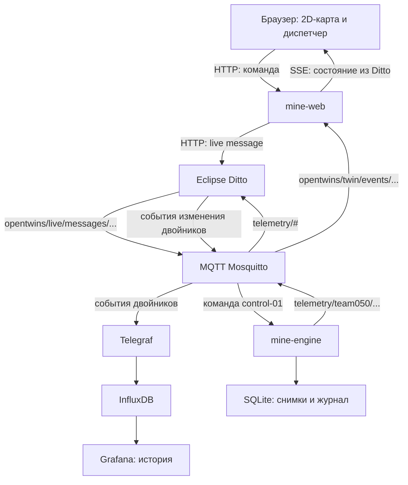
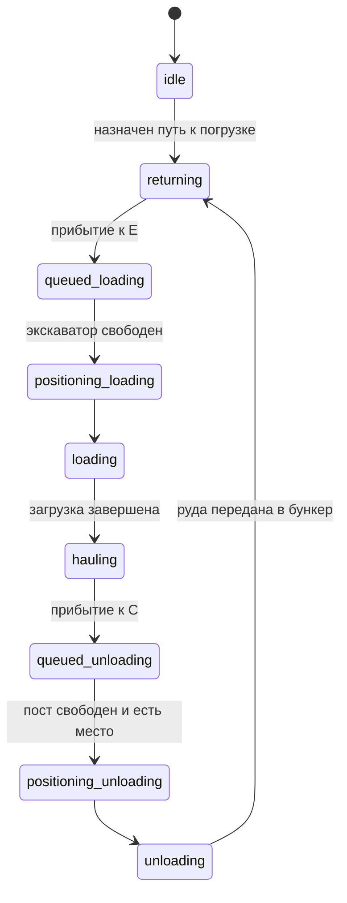

> Документ исходного планирования. Дополнения от 25 октября (загрузка 230–250 т, топливо, заправка и случайные поломки): [актуальные правила](planning/ОПЕРАЦИОННАЯ_МОДЕЛЬ.md). Исторические расчёты ниже сохранены для прослеживаемости решений.

# Техническая схема цифрового карьера

Дата: 21 октября 2026 года. Версия проекта схемы: 1.1 — команда согласовала Go + TypeScript.

**Статус:** архивный проект ранней архитектуры. Его исходные разделы фиксируют замысел до расширения симуляции и не являются полным описанием текущей сборки. Актуальные функции, запуск и ограничения: [README.md](README.md) и [SUBMISSION.md](SUBMISSION.md).

Основа: [решения команды](РЕШЕНИЯ_ПО_ПРОЕКТУ.md), [параметры](ПАРАМЕТРЫ_СИМУЛЯЦИИ.md), [карта](planning/README.md), документация и исходные конфигурации OpenEgiz в этом репозитории. Технические решения этого документа выбраны для реализации согласованной концепции; они не превращают открытые производственные параметры в утверждённые нормы.

## 1. Что создаём первым

Рабочее место диспетчера с 2D-картой сверху: четыре места погрузки, 20 рабочих самосвалов, три независимые дробилки и шесть шаблонов маршрутов. Диспетчер также составляет индивидуальные маршруты по существующим дорогам.

Машины проходят цикл погрузка → движение с грузом → ожидание и разгрузка → возвращение. Дробилки перерабатывают материал из бункеров независимо от момента разгрузки. Сменный результат считается по переработанной руде.

Первая версия не включает поломки, ремонт, расход топлива и ввод резерва. Ремонтные площадки и стоянка остаются на карте. Для следующих этапов предусмотрены отдельные состояния и модули; они не участвуют в расчётах первой смены.

Смена длится 12 модельных часов, начальное ускорение ×30. После первого полного прогона команда определяет начальные нормативы по измеренным результатам.

## 2. Компоненты и технологии

| Компонент | Выбранное техническое решение | Ответственность |
|---|---|---|
| `mine-engine` | Go, MQTT-клиент для Go | Время, движение, очереди, погрузка, бункеры, переработка, исполнение команд и результаты смены |
| `mine-web` | Go, стандартный пакет `net/http`, SSE, MQTT-клиент для Go | Раздача интерфейса, приём запросов, передача команд в Ditto, зеркало состояния Ditto и поток обновлений браузеру |
| Интерфейс | TypeScript, Vite при сборке, SVG-карта и обычные HTML-элементы управления | Выбор техники, построение пути, отображение двойников и статистики |
| `mine-setup` | Одноразовый процесс на Go | Создание собственных двойников и загрузка начальных конфигураций |
| OpenEgiz | Существующие Mosquitto, Ditto, Telegraf, InfluxDB, Grafana | Двойники, транспорт, история и просмотр данных платформы |
| Хранилище модели | SQLite и файлы отчётов в Docker volume | Снимки для восстановления, журнал команд, исходные параметры и результаты прогонов |

Для схематичной карты с 20–25 машинами отдельный игровой движок не требуется: SVG содержит дороги и значки, HTML — панели и кнопки. Позднейший 3D-вид использует тот же контракт данных. Версии зависимостей и образы закрепляются при реализации; браузер получает локально собранные файлы без обязательных CDN.

`mine-engine` и `mine-web` — разные процессы. Сетевые обработчики работают в отдельных goroutines и передают сообщения через ограниченные очереди/channels. Расчётным состоянием владеет одна goroutine симуляции: она последовательно обрабатывает шаги и команды. Сетевые обработчики не меняют расчётные объекты напрямую. Только один экземпляр `mine-engine` владеет активной сменой.

По решению команды собственные серверные сервисы и инициализатор реализуются на Go. Python в платформенных примерах остаётся справочным материалом по протоколу. Версия Go, конкретный MQTT-клиент и драйвер SQLite закрепляются при реализации с учётом сборки Docker-образа для Ubuntu amd64. Зависимости Go фиксируются в `go.mod` и `go.sum`; интерфейс имеет отдельный lock-файл пакетов.

## 3. Общая схема



Здесь MQTT-топики и поле `topic` внутри JSON — разные вещи. `telemetry/team050/truck-01` является адресом брокера, а `org.openegiz.team050/truck-01/things/twin/commands/modify` — адресом команды протокола Ditto внутри сообщения.

### Кто владеет состоянием

- **Симулятор** — единственный источник расчётных изменений: позиции, масса, очереди, состояния механизмов и модельное время.
- **Ditto** — опубликованное текущее состояние цифровых двойников. Интерфейс получает производственные данные через него.
- **`mine-web`** — зеркало подтверждённых событий Ditto, а не второй симулятор. При начальном подключении или восстановлении он читает двойники по REST API Ditto.
- **InfluxDB** — история, а не источник управления движением. В штатной конфигурации Telegraf выгружает данные примерно раз в 10 реальных секунд.
- **Браузер** — отображение и пользовательский ввод. Закрытие вкладки не останавливает серверную смену; другая вкладка подключается к той же смене.

Прямого канала `mine-engine → браузер` с производственным состоянием не предусматривается. Журнал запросов и технический статус соединений могут передаваться отдельно от состояния техники.

## 4. Двойники Ditto

Собственное пространство имён — `org.openegiz.team050`. Оно отделено от `org.openegiz.mine`, используемого примером платформы.

| Thing ID | Количество в первой версии | Назначение |
|---|---:|---|
| `org.openegiz.team050:mine-01` | 1 | Участок, агрегаты тоннажа и ссылка на действующий прогон |
| `org.openegiz.team050:control-01` | 1 | Часы смены, режим, скорость и адресат команд диспетчера |
| `org.openegiz.team050:roads-01` | 1 | Граф дорог, расположение объектов и шаблоны M1–M6 |
| `org.openegiz.team050:truck-01` … `truck-20` | 20 | Самосвалы первой версии |
| `org.openegiz.team050:excavator-01` … `excavator-04` | 4 | Экскаваторы на E1–E4 и связанные очереди погрузки |
| `org.openegiz.team050:crusher-01` … `crusher-03` | 3 | Дробилки C1–C3, бункеры и очереди разгрузки |

Итого **30 двойников** в первой версии. E1–E4 и бункеры сначала входят в соответствующие двойники оборудования; отдельные дополнительные сущности для них не создаются.

В полной версии добавляются пять резервных машин `truck-21` … `truck-25`, две площадки `repair-01`, `repair-02` и стоянка `reserve-01`: всего 38 двойников. Это план расширения, а не существующие объекты реализации.

### Постоянные данные: `attributes`

Общие поля: `name`, `kind`, `_isType: false`; у дочерних объектов `_parents: "org.openegiz.team050:mine-01"`. Такая строковая ссылка соответствует иерархии примера OpenEgiz.

- Машина: модель, `capacity_t`, `body_m3`; экскаватор: `bucket_m3`, узел E.
- Дробилка: узел C, конфигурация мощности и `buffer_capacity_t=720`. Для C3 конфигурация содержит нижнюю и верхнюю мощности и интервал чередования 4050 модельных секунд; текущая мощность публикуется feature.
- Дороги: `topology_version`, `layout_version`, узлы, отрезки и шаблоны.
- Участок: версия конфигурации и список ID ожидаемых двойников.

Большие статические структуры не повторяются в каждом пакете телеметрии. Начальная конфигурация и хеши сохраняются также в архиве прогона.

### Изменяемые данные: `features`

Каждая метрика имеет вид `{"properties":{"value":...,"unit":"..."}}`; единица нужна для физических величин. Основные значения — числа, строки или булевы значения. Последовательности узлов, очереди и сведения о последней команде передаются ограниченными по размеру JSON-строками в `value`, чтобы не создавать переменное число полей InfluxDB.

| Двойник | Основные features |
|---|---|
| Все | `idSimulationRun`, `snapshot_seq`, `sim_time_s` |
| `mine-01` | `loaded_t`, `delivered_t`, `processed_t`, `truck_payload_total_t`, `buffer_total_t`, `plan_t`, `plan_defined`, `plan_completion_pct`, `active_trucks`, `run_report_json` — пустая строка до итогового отчёта |
| `control-01` | `state`, `speedup`, `shift_duration_s`, `config_hash`, `last_command_id`, `last_command_status` |
| `roads-01` | `topology_version`, `closed_edges_json` — в первой версии пустой список |
| Самосвал | `state`, `payload_t`, `speed_kmh`, `edge_id`, `edge_progress`, `node_id`, `route_id`, `route_json`, `pending_route_json`, `route_revision`, `trips_total`, `queue_wait_s`, `operation_elapsed_s` |
| Экскаватор | `state`, `current_truck_id`, `queue_json`, `queue_length`, `loaded_t`, `passes_total`, `busy_s`, `idle_s` |
| Дробилка | `state`, `current_truck_id`, `queue_json`, `queue_length`, `buffer_t`, `reserved_buffer_t`, `delivered_t`, `processed_t`, `capacity_tph`, `throughput_tph`, `busy_s`, `starved_s` |

`idSimulationRun` — идентификатор именно прогона. Имя поля выбрано под уже существующий тег Telegraf. `snapshot_seq` — возрастающий номер опубликованного кадра, одинаковый у всех объектов одного кадра; он не является количеством рейсов.

Команда приняла диапазон сменного плана 93 000–95 000 т переработанной руды. `plan_defined=true`, `plan_t` хранится в состоянии, `plan_completion_pct=processed_t/plan_t×100`. Для независимого нового прогона выбирается значение в диапазоне, повтор сохраняет прежнее. При обновлении начатого прогона без плана принимается 94 000 т. Старые завершённые отчёты с `plan_defined=false` не переписываются.

Поля первой версии не обещают расчёт топлива или ремонта: соответствующие features появляются вместе с работающими модулями.

## 5. Единая расчётная модель

### Время

Один фиксированный шаг — **1 модельная секунда**, независимо от ×1/×10/×30/×60. При ×30 за реальную секунду обрабатывается 30 шагов, при ×60 — 60. Используется монотонный таймер реального времени. Отрисовка и частота сетевых публикаций не определяют длительность погрузки или выпуск дробилки.

За шаг выполняются: команды в установленном порядке → завершения операций и перемещения → обслуживание очередей → переработка → обновление счётчиков. Время внутри шага распределяется по фактическим переходам; завершение операции не создаёт лишнюю секунду работы следующей. Для равновременных событий порядок стабилен по типу события и ID объекта.

При паузе физические шаги останавливаются, но обработка команд и сетевое соединение продолжаются. Если компьютер не успевает, шаги не пропускаются: замедляется просмотр и показывается отставание. Результат не должен зависеть от мощности компьютера или скорости просмотра.

Смена завершается ровно на `sim_time_s=43200`: материал в пути и бункерах остаётся в остатках. Дополнительная переработка после окончания смены не засчитывается.

### Состояния самосвала



Согласованное начальное положение всех 20 рабочих машин — гараж P, пустые кузова, состояние `idle`. В полной модели пять резервных также стоят в P, но не выезжают без решения о вводе резерва. В первой версии резервные двойники ещё не создаются.

После запуска смены машина с назначением переходит в `returning` — общее состояние пустого движения к погрузке, включая первый выезд. Сначала она проходит P–J1 (0,6 км), затем путь до своего E. Первый выезд занимает модельное время внутри смены; мгновенная установка машины на E не допускается. Машина без назначения остаётся в P в `idle`. Распределение первых назначений пока открыто.

В первой версии очереди FIFO с устойчивым порядком при одинаковом времени прибытия. Один экскаватор обслуживает одну машину; у каждой дробилки один пост разгрузки.

Тонны переходят в кузов при завершении подач экскаватора с ограничением объёма кузова и нагрузки. Начальные параметры уже выбраны по поручению команды: 29 м³ × 0,90 × 1,70 т/м³ = 44,37 т на обычную подачу, цикл 50 модельных секунд. Пять обычных подач и последняя дозированная 18,15 т дают 240 т за 300 секунд, плюс отдельные 60 секунд постановки. Неполная подача занимает тот же цикл; кузов получает только фактическую массу и объём. Общий алгоритм ограничивает каждую подачу оставшейся массой и свободным объёмом. Независимый таймер «всегда пять минут» не используется; при изменении параметров длительность пересчитывается. Подробности и источники — в [параметрах](ПАРАМЕТРЫ_СИМУЛЯЦИИ.md).

В первой реализации разгрузка передаёт весь груз в бункер в момент завершения операции. Начальная вместимость каждой дробилки — 720 т, три загрузки самосвала, исходный запас — ноль. Перед началом резервируется свободное место под фактический груз, чтобы не переполнить бункер; используется `720 − buffer_t − reserved_buffer_t`. При завершении резерв снимается и груз добавляется в бункер. Полный бункер задерживает очередь; освободившийся бункер позволяет продолжить работу.

Дробилка уменьшает `buffer_t` и увеличивает `processed_t` на одну и ту же массу, ограниченную доступной рудой и мощностью за фактическое время. Состояния: `idle`, `crushing`, `starved`; поломка добавляется позднее. После завершения разгрузки руда не может считаться переработанной задним числом за весь уже прошедший шаг.

### Материальный баланс

Для первой версии без потерь:

```text
начальный груз машин + загружено = доставлено + текущий груз машин
начальный запас бункеров + доставлено = переработано + текущий запас бункеров
```

Суммы считаются по всем машинам и дробилкам. `delivered_t` меняется при передаче груза, `processed_t` — при переработке. `trips_total` увеличивается после завершённой разгрузки. Внутренние расчёты не округляются до десятых на каждом шаге; округление применяется при отображении.

Мощности дробилок задаются конфигурацией и не меняются автоматически при переназначении транспорта. Начальная калибровка по пожеланию команды: C1 — `3200 × 14 / 15` т/ч, C2 — `3200 × 15,7 / 15` т/ч; C3 чередует 3136 и 3264 т/ч каждые 4050 модельных секунд, начиная с 3136. При переходе через границу режимов шаг разделяется по времени, чтобы использовать правильную мощность в каждом интервале. Эталон 3200 т/ч рассчитан от четырёх экскаваторов и равномерного распределения их теоретической непрерывной подачи; это не измеренная подача по маршрутам. Различия точны для эталона 15 загрузок за 67,5 минуты. Текущая `capacity_tph` отличается от фактической `throughput_tph`, ограниченной наличием руды. Подробности — в [параметрах](ПАРАМЕТРЫ_СИМУЛЯЦИИ.md). Числовой сменный норматив не нужен для начала работы модели.

## 6. Дороги и назначение маршрутов

Расчёт использует граф из [карты](planning/README.md). Отрезок хранит `id`, `from`, `to`, `length_km`, доступность и ограничения. Двусторонняя дорога допускает проезд в обоих направлениях.

Координаты SVG задают только внешний вид. Время движения считается по `length_km` и скорости 20 км/ч с грузом или 30 км/ч без груза. Длина нарисованной линии в пикселях не является длиной дороги. Пересечение линий без узла не соединяет дороги.

Для первой реализации предлагается начальное допущение: дороги допускают встречное движение без моделирования столкновений и дорожных заторов; очереди моделируются у оборудования. Это отдельно фиксируется в конфигурации первого прогона. Уклоны и дорожная пропускная способность требуют последующего уточнения.

### Контракт пути

- План цикла: узел погрузки, узел дробилки, последовательность узлов гружёного пути. Возврат по умолчанию идёт по тому же пути в обратном направлении.
- Шаблоны M1–M6 хранятся как исходные данные. Для назначения машина получает свою копию плана; изменение одной машины не изменяет шаблон и остальных.
- Пользовательский путь обязан проходить только по существующим доступным рёбрам и иметь допустимые начало и конец. В первой версии пути без повторов узлов: случайные циклы отклоняются.
- Перед подтверждением сервер возвращает нормализованный план, расстояние, расчётное время движения без очередей и точку применения. Это предварительная оценка, не обещанное время полного рейса.
- Команда содержит `expected_route_revision` и `topology_version`: устаревший план отклоняется с объяснением. Нельзя незаметно перезаписать более новое назначение другой вкладки.

У движущейся машины текущий отрезок завершается. Новый путь применяется на ближайшем допустимом узле через `pending_route_json`. Гружёная машина сохраняет руду и сначала едет на допустимую разгрузку; смена места следующей погрузки не выгружает кузов и не переносит его на E.

Маршрут предварительного перехода от текущего положения к новому плану строится сервером по доступным дорогам и показывается при просмотре назначения. При невозможном переходе команда отклоняется. Уже начатая погрузка или разгрузка завершается перед сменой пути. Освобождение очереди при переназначении выполняет расчётный модуль один раз.

На узле `node_id` заполнен; на отрезке заполнены `edge_id` и `edge_progress` от 0 до 1. `edge_id` содержит направление, например `J1>J3`. Это исключает неоднозначность положения при встречном движении.

## 7. Телеметрия: симулятор → MQTT → Ditto

Начальные двойники создаются через `PUT /api/2/things/{thingId}` с `policyId=default:basic_policy`, как в платформенном примере. Инициализация выполняется до запуска модели и не перезаписывает действующую смену при каждом рестарте.

Рабочая телеметрия публикуется в `telemetry/team050/{name}`. Конфигурация OpenEgiz уже слушает `telemetry/#`; специальный преобразователь payload не требуется.

Оболочка сообщения:

```text
topic = org.openegiz.team050/{name}/things/twin/commands/modify
path  = /features
value = полный набор features этого двойника
```

Каждое значение внутри `value` имеет форму `featureName: {properties: {value: ..., unit: ...}}`. Отправляется полный набор текущих features, поскольку `modify` на `/features` заменяет их целиком. Узкое обновление `/features/payload_t/properties/value` не используется для регулярной телеметрии: оно нарушает принятые в платформе имена полей истории.

Целевая частота — не более одного нового полного кадра в **реальную секунду**. Команды, смена режима и завершение смены помечают состояние для следующей публикации. Одновременно передаётся только один неизменяемый кадр: следующий отправляется после событий Ditto для всех 30 объектов предыдущего. Промежуточные сетевые снимки объединяются в последнее состояние, расчётные шаги и команды сохраняются отдельно. Кадр имеет единые `idSimulationRun`, `snapshot_seq` и `sim_time_s`. Номер увеличивается для нового кадра, повтор недоставленных объектов сохраняет тот же номер.

MQTT publish — QoS 1, `retain=false`. При этом существующая входящая подписка Ditto имеет QoS 0: PUBACK брокера не означает, что Ditto уже обновил двойник. Движок ждёт совпадающих по прогону и номеру кадра событий; отсутствующие объекты повторяет раз в 10 реальных секунд. При повторе также читает их REST API Ditto: это подтверждает сохранение, если обратное событие было потеряно. Одновременно выполняется не более четырёх чтений и одного прохода восстановления. Это ограничивает нагрузку при медленной платформе и восстанавливает пропущенные обновления. Для UI подтверждением служит событие из Ditto или чтение его REST API.

После изменения двойника платформа публикует событие на:

```text
team050/ditto/twin/events/org.openegiz.team050/{name}
```

Исходящий канал модели — отдельное соединение Ditto `team050-target`, создаваемое `mine-setup` по `team/mine/config/mqtt-target.json`. Фильтр `namespaces` ограничивает его объектами команды. События и live messages публикуются без `extraFields`; полный `modify /features` уже содержит значения и номер кадра. Это устраняет зависимость карты от дополнительного чтения двойников при обогащении общего канала платформы. Telegraf получает эти события, определяет `thingId` из topic протокола Ditto и сохраняет прежние имена полей истории. Данные других пространств продолжают идти через общий канал.

После переподключения движок завершает подтверждение текущего кадра, затем публикует последнее состояние. Один издатель и один кадр в полёте ограничивают очередь. Если брокер отключён или 20 реальных секунд нет подтверждений текущего кадра, работающая модель переходит на техническую паузу с сохранением состояния; после восстановления продолжение запускает пользователь. Поздние повторы самого транспорта могут кратковременно вернуть старое значение отдельного двойника, поэтому зеркало принимает только полные кадры и отбрасывает меньшие номера. После перезапуска движок читает сохранённый номер и начинает новый кадр.

## 8. Команды диспетчера через Ditto

Новая команда после сохранения немедленно будит отправителя. Сетевые отправки кадров и ответов выполняются вне единственного расчётного цикла, через ограниченные очереди. Одновременно отправляется не более одного кадра. При заполнении очереди ответов результат остаётся в SQLite и возвращается при идемпотентном повторе команды. Неудачные отправки команд повторяются с увеличением интервала до 32 с; уже принятые отложенные назначения опрашиваются не чаще раза в 30 с. Новые команды отправляются раньше повторных; ограничения ревизии по-прежнему проверяет движок. Один HTTP-запрос отправителя ограничен 5 с, поэтому зависший запрос не удерживает очередь на прежние 20 с.

Управление не выполняется произвольной записью `state` или `payload_t` в двойник. Браузер отправляет намерение, симулятор проверяет и исполняет его.

### Путь команды

1. Браузер вызывает `POST /api/commands` у `mine-web`.
2. `mine-web` проверяет формат, сессию и допустимость команды для роли; сохраняет запрос и идентификатор.
3. Сервер отправляет JSON в Ditto:

   ```text
   POST /api/2/things/org.openegiz.team050:control-01/inbox/messages/dispatch?timeout=0
   Content-Type: application/json
   correlation-id: <command_id>
   ```

4. Ditto направляет live message в имеющийся MQTT target. `mine-engine` подписан на `team050/ditto/live/messages/org.openegiz.team050/control-01` и принимает только `/inbox/messages/dispatch`.
5. Обработчик MQTT ставит команду в очередь. Единственный расчётный цикл повторно проверяет текущую смену, ревизии и ограничения, затем применяет изменение или назначает его на безопасную точку.
6. Результат команды возвращается через отдельное live message из симулятора в Ditto и затем в `mine-web`. Физическое состояние меняется в телеметрии двойников.

`timeout=0` даёт быстрое HTTP `202 Accepted`, но не означает выполнение действия: это транспортное принятие Ditto. Это различие соответствует [HTTP Messages API Ditto](https://eclipse.dev/ditto/httpapi-messages.html).

### Тело команды: пример назначения

```json
{
  "schema_version": 1,
  "command_id": "f9e56e4e-062f-4c19-b876-5a8f26aac631",
  "run_id": "run-example-001",
  "type": "assign_route",
  "target_id": "org.openegiz.team050:truck-01",
  "expected_route_revision": 3,
  "topology_version": "map-v1",
  "parameters": {
    "loading_node": "E1",
    "crusher_node": "C1",
    "loaded_path": ["E1", "J1", "J3", "C1"]
  }
}
```

`run-example-001` — иллюстрация; рабочий `run_id` генерируется сервером. Поле роли из браузера не считается подтверждением полномочий. Проверку роли и сведения об отправителе добавляет сервер сессий.

### Команды первой версии

| Тип | Назначение |
|---|---|
| `start_shift` | Начать подготовленную смену |
| `pause_shift` / `resume_shift` | Пауза и продолжение |
| `set_speed` | Выбрать ×1/×10/×30/×60 |
| `assign_route` | Назначить шаблон или индивидуальный путь выбранному самосвалу |
| `repeat_shift` | Повторить прогон с теми же начальными назначениями и расписанием ручных отказов, сохранив прежние отчёты |

Приведённое описание полномочий относится к ранней базовой версии документа. В текущей сборке добавлены одиночное переключение ролей диспетчера и механика, обслуживание и ремонт; резерв и совместный режим не реализованы. Точный пользовательский порядок см. в README.md и planning/ПОЛОМКИ_И_РЕМОНТ.md.

### Исполнение, повторные сообщения и ответы

Статусы: `received` → `scheduled` → `applied`, либо `rejected`. Мгновенное изменение может сразу перейти из `received` в `applied`. `scheduled` означает, что, например, новый путь ожидает ближайшего допустимого узла; физическое действие ещё не завершено.

Команда идентифицируется по `(run_id, command_id)`. Повтор с тем же ID и тем же содержимым возвращает записанный статус без повторного исполнения. Тот же ID с другим телом отклоняется. Журнал и изменение расчётного состояния сохраняются согласованно в SQLite. Только MQTT QoS не обеспечивает эту идемпотентность.

Отложенные назначения имеют запись в очереди модели. При более новом назначении прежняя команда получает конечный статус `superseded`; исчезновение из `pending_route_json` не считается молчаливым выполнением. При завершении смены неисполненные назначения получают `cancelled`.

Для ответа симулятор отправляет в `telemetry/team050/control-01` новое сообщение протокола Ditto:

```text
topic   = org.openegiz.team050/control-01/things/live/messages/command_result
path    = /outbox/messages/command_result
headers = {content-type: application/json, correlation-id: <command_id>}
value   = {command_id, run_id, status, reason_code, message, sim_time_s, snapshot_seq}
```

Это отдельное outbox-сообщение приложения, не попытка отвечать на HTTP-запрос, который уже завершился через `timeout=0`. Его Ditto-путь соответствует [протоколу Messages](https://eclipse.dev/ditto/protocol-specification-things-messages.html). `mine-web` принимает только `/outbox/messages/command_result` своего `control-01`.

HTTP-ответ `202` нашего API означает «запрос поставлен на отправку». Окончательный статус приходит отдельно; при потере ответа `mine-web` повторяет ту же команду с тем же ID и получает состояние из журнала симулятора. Сначала проверяется уже записанный ID, затем актуальность смены — это позволяет получить результат повторённой команды `repeat_shift`, уже создавшей новый прогон.

Причины отказа кодируются, например, `STALE_RUN`, `STALE_ROUTE`, `INVALID_PATH`, `UNREACHABLE_TARGET`, `SHIFT_FINISHED`, `FORBIDDEN`. Пауза не должна блокировать получение команды продолжения. Неизвестная доставка отображается как «Нет подтверждения», а не как успех.

## 9. Состояние Ditto → API → 2D-карта

`mine-web` сначала подписывается на события своего пространства имён, затем читает список ожидаемых двойников по точным ID из манифеста через `GET /api/2/things/{thingId}`. Это не зависит от задержки индекса поиска Ditto. Чтения ограничены по параллельности; пришедшие во время загрузки события сверяются по прогону и номеру кадра.

В памяти хранится только зеркало Ditto. Произвольные сообщения браузера и необработанные публикации `telemetry/#` в зеркало не попадают. Передаются лишь ожидаемые двойники и разрешённые поля.

Ditto обновляет разные объекты независимо: публикация 30 двойников не является одной транзакцией. `mine-web` собирает согласованный кадр по `(idSimulationRun, snapshot_seq)` и ожидаемому списку ID. Хранится ограниченное число незавершённых кадров; более ранние подтверждённые кадры не заменяют более новые. Если кадр неполный, карта сохраняет предыдущий полный и показывает задержку. Следующий полный кадр восстанавливает работу; при длительном разрыве выполняется повторное чтение Ditto. Нельзя смешивать статистику и машины из разных прогонов.

### Внутренний API нашего приложения

| Метод и путь | Что возвращает или делает |
|---|---|
| `GET /api/topology` | Граф, раскладка и шаблоны из атрибутов двойника дорог |
| `GET /api/state` | Последний полный кадр, полученный из Ditto, плюс признак устаревания |
| `GET /api/stream` | SSE-поток подтверждённых кадров, статусов команд и соединений |
| `POST /api/routes/preview` | Предварительный план и оценка по опубликованной карте и состоянию; расчётный модуль проверяет повторно при исполнении |
| `POST /api/commands` | Очередь отправки команды в Ditto |
| `GET /api/commands/{command_id}` | Последний известный статус, включая «Нет подтверждения» |
| `GET /api/runs` | Список сохранённых прогонов и отчётов, опубликованных симулятором через двойники и сохранённых `mine-web` |
| `GET /healthz` / `GET /readyz` | Жив ли сервис / готовы ли Ditto, MQTT и полный кадр модели |

Браузер подключается только к своему HTTP-серверу. Пароль Ditto и токен InfluxDB остаются в серверном окружении; в JavaScript, URL страницы и репозиторий они не попадают.

Первая версия предназначена для локального стенда с одной диспетчерской сессией. Изменяющие запросы проверяют сессию и происхождение запроса; внутренние MQTT-адреса недоступны браузеру. Полноценные три пользовательские роли и их вход реализуются на отдельном этапе, а не имитируются переключателем без серверной проверки.

SVG отображает координаты на текущем отрезке из графа. Допустима плавная интерполяция между двумя подтверждёнными позициями одного маршрута. При отсутствии свежего кадра движение замирает с пометкой потери связи; браузер не рассчитывает будущие разгрузки, переработку и новые состояния. Пауза, окончание смены, переназначение и смена прогона немедленно прекращают старую анимацию.

### Утверждённый интерфейс первой версии

Команда согласовала следующий обязательный набор:

- 2D-карта с движущимися машинами;
- карточка выбранного самосвала;
- назначение шаблона или построение своего маршрута;
- запуск, пауза, выбор скорости и повтор смены;
- часы, очереди, доставленные и переработанные тонны;
- журнал событий и результатов команд.

Выбор машины связывает её карточку с подсветкой пути на карте; предварительный просмотр и подтверждение назначения используют описанный выше API. Результаты команд различают принятие, отложенное применение, выполнение и отказ. Физические действия и тоннажи отображаются из подтверждённого состояния Ditto. Визуальная компоновка определяется при реализации и не требует повторного выбора состава интерфейса.

## 10. История и результаты смены

Используем штатные `bucket=default`, measurement `mqtt_consumer`, тег `thingId`; поля вида `value_payload_t_properties_value` и `value_processed_t_properties_value`. Тег `idSimulationRun` уже предусмотрен Telegraf через обогащение событий Ditto.

Командный overlay использует собственную конфигурацию Telegraf с подпиской `opentwins/twin/events/#` вместо `opentwins/#`. История продолжит принимать изменения двойников, а live-команды и их ответы не будут передаваться JSON-парсеру метрик. Существующие source/target connections Ditto менять для первой версии не требуется. Конфигурация подключается overlay при запуске командной модели.

Штатные точки InfluxDB используют реальное время приёма. 12 модельных часов при ×30 выглядят как примерно 24 минуты реальной истории. Для длительностей и сменных нормативов используются `sim_time_s` и расчётные счётчики, а не разница настенных отметок InfluxDB. Сравнивать прогоны без фильтра по `idSimulationRun` нельзя; числовые и строковые метрики в Grafana запрашиваются раздельно.

Точные операции и команды симулятор сохраняет в локальном журнале, поскольку секундная телеметрия и десятисекундная выгрузка не являются журналом всех переходов модели. Итоговые агрегаты и ограниченный JSON-отчёт публикуются features двойника `mine-01` в конце смены. `mine-web` сохраняет подтверждённый итог по событию Ditto, чтобы показать его в списке прогонов.

Отчёт первого прогона содержит:

- `run_id`, версии схемы/кода, хеш конфигурации, seed и начальное размещение;
- исходное назначение маршрутов, журнал решений диспетчера;
- длительности погрузки, разгрузки, оборота и отдельное ожидание;
- рейсы, загруженные, доставленные и переработанные тонны;
- работу каждой дробилки, очереди, простои и конечные остатки;
- признак отсутствия принятого норматива до решения команды.

После просмотра результатов норматив сохраняется отдельно вместе с ID исходного прогона и конфигурацией. Изменение парка или параметров не переписывает прежние результаты; допускается новый норматив по новому прогону.

## 11. Сохранение, повтор и расширение

Сохраняются расчётное состояние, очереди, таймеры, текущие и отложенные маршруты, номер кадра, журнал команд и состояние генераторов случайных чисел. Объекты SVG и открытые окна браузера в снимок не входят. Единственный движок удерживает блокировку каталога своей смены; второй экземпляр с тем же хранилищем не начинает расчёт. Масштабирование числа расчётных процессов одной смены не предусматривается.

При штатной остановке — согласованный снимок. При аварии — последний сохранённый снимок и последующий журнал событий. После рестарта восстановленная смена находится на паузе; её продолжение требует согласования с последними сохранёнными номерами публикаций, без повторного учёта груза или отката уже опубликованной смены. Если согласованное восстановление невозможно, создаётся новый явно обозначенный прогон вместо продолжения с прежним ID и уменьшенными счётчиками.

`repeat_shift` создаёт новый ID с тем же начальным состоянием и конфигурацией. В первой версии случайные поломки отсутствуют. В полной версии события отказов привязываются к seed и модельному времени отдельным потоком, а не к порядку отрисовки. Для сравнения решений сохраняются расписание внешних событий и команды; зависящие от профилактики последствия пересчитываются по действиям пользователя.

Будущие модули подключаются к тому же расчётному циклу: `failures`, `maintenance`, `fuel`, `reserve`, `roles`. Три пользователя получают одну смену из одного сервера; локальные симуляции в трёх браузерах не создаются. Позднейший 3D-клиент читает тот же API, ID объектов и дорожные координаты; правила движения не копируются в сцену.

## 12. Размещение в репозитории и запуск

Предлагаемая структура будущей реализации:

```text
team/
  mine/
    go.mod        модуль серверной части
    go.sum        контрольные суммы зависимостей
    cmd/          точки входа mine-engine, mine-web, mine-setup
    config/       site.json, routes.json, equipment.json, scenario.json
    domain/       clock, trucks, loading, roads, queues, crushers, metrics
    transport/    ditto_protocol, mqtt, command_dispatch
    persistence/  snapshots, command_journal, reports
    web/          HTTP API, Ditto mirror, SSE, sessions
    ui/           TypeScript, SVG, HTML/CSS, локальные ресурсы
    setup/        создание двойников и манифест
    compose.yml   overlay на платформу
    Dockerfile    сборка собственных сервисов
scripts/
  team-up.sh      подготовка окружения и запуск всего стенда
  team-down.sh    остановка с сохранением volumes
```

Основная реализация размещена по этим путям; три точки входа находятся в `cmd/`. Карта draw.io — редактируемый макет; при реализации её граф и координаты переносятся в версионируемую конфигурацию, которая используется всеми компонентами.

Overlay добавит `mine-setup`, `mine-engine`, `mine-web` в общую Compose-сеть платформы. Адреса внутри сети: `mosquitto:1883`, `http://ditto-nginx:80`. Окружение и пароли берутся из сгенерированного `deploy/compose/.env`. Инициализатор зависит от успешного платформенного `init`, движок — от создания двойников. Для образа, общего нескольким сервисам, `build` задаётся только у одного сервиса, как предусмотрено примером платформы.

Предлагаемый отдельный адрес карты — `http://127.0.0.1:8088`; порт настраивается, по умолчанию привязан к `127.0.0.1`. Grafana остаётся на 3000, API Ditto — на 8080, сервер будущего Unity — на 8090. В Grafana и README будет ссылка на карту; сама карта получает состояние из платформы через серверное зеркало Ditto.

При реализации `team-up.sh` должен подготовить `.env` штатным скриптом, подключить базовый Compose и overlay с явным `--env-file`, собрать UI и контейнеры, дождаться готовности и вывести адреса. Он запускается из Ubuntu/WSL и не требует установленного `make`. Обычные запуск и остановка должны включать собственные сервисы; пример `mine-simulator` не запускается параллельно автоматически. Остановка сохраняет данные; удаление volumes не входит в обычный сценарий закрытия.

## 13. Порядок реализации и оставшиеся входные параметры

Команда оценит окончательную готовность и предложит изменения после создания и запуска первой версии. Полный производственный цикл, состояние через OpenEgiz, 2D-карта и отчёт за 12 часов остаются рабочими ориентирами разработки. Предварительная окончательная приёмка или дополнительное согласование её критериев не являются условием начала реализации.

1. Создать версионируемый граф согласованной карты, модели техники и манифест 30 двойников.
2. Перенести выбранные параметры подачи, мощности дробилок и бункеры в конфигурацию; задать первые маршруты 20 машин. Начальное размещение уже выбрано: все машины в гараже P. Это настройки первого прогона, не сменные нормативы.
3. Реализовать расчётный цикл, очереди и раздельный учёт разгрузки и переработки.
4. Подключить MQTT-публикацию собственных двойников и чтение подтверждённого состояния Ditto.
5. Подключить команды через Ditto, статусы и защиту от повторного исполнения.
6. Сделать 2D-карту, назначение шаблонов и индивидуальных путей.
7. Подключить историю, сохранение и полный 12-часовой прогон для последующего принятия нормативов командой.

Архитектура не требует сначала определять точный сменный план. До расчётного запуска остаются первые назначения маршрутов и фиксация дорожных допущений. Параметры загрузки, мощности дробилок и бункеры уже заданы; начальная позиция всех самосвалов — гараж P. Частота поломок, эвакуация, топливо и дополнительные полномочия относятся к следующему этапу.

## 14. Основания и границы подтверждения

### Расширение: средняя поломка и ремонт

К 30 двойникам первой версии добавлены `repair-01` и `repair-02`: теперь полный кадр содержит 32 объекта. `mine-setup` создаёт недостающие площадки и обновляет только атрибут manifest существующего корневого двойника, сохраняя его рабочие features. Старое сохранение получает свободные площадки R1/R2; конфигурация дорог и прежние отчёты сохраняются.

Управление: `inject_failure` от диспетчера; `send_to_repair` с `parameters.repair_node` (R1/R2 либо пусто — ближайшая) и `prioritize_repair` от механика. Роль передаётся в `role` и проверяется движком; пока это одиночное переключение, не многопользовательская авторизация.

Цепочка состояний: `failed → to_repair → queued_repair → diagnosing → repairing → hauling/returning/idle`. Машина сохраняет груз и положение; текущая производственная операция прерывается, её ресурсы освобождаются. Диагностика — 300 с, ремонт — 3000 с, движение к площадке — 10 км/ч. Статистика ремонта, сценарий ручных поломок и их повтор описаны в [инструкции](planning/ПОЛОМКИ_И_РЕМОНТ.md).

Локальные источники, прочитанные при подготовке:

- [OPENEGIZ.md](OPENEGIZ.md): создание двойников, полный `modify /features`, имена полей истории и задержка выгрузки.
- [Описание примера](examples/mine/README.ru.md), [симулятор](examples/mine/simulator.py), [инициализатор](examples/mine/setup_twins.py): формат интеграции, не производственная логика нашей модели.
- [MQTT source](deploy/compose/init/mosquitto-source-connection.json), [MQTT target](deploy/compose/init/mosquitto-target-connection.json): подписки, live messages, адреса и QoS.
- [Telegraf](deploy/compose/telegraf/telegraf.conf): поля, теги, `idSimulationRun` и период выгрузки.
- [Compose](deploy/compose/docker-compose.yml), [overlay примера](examples/mine/compose.yml), [инициализация](deploy/compose/init/setup.sh): сеть, порядок запуска и политика.

Формат live messages и семантика `timeout=0` дополнительно сверены с официальными страницами [HTTP API Messages](https://eclipse.dev/ditto/httpapi-messages.html) и [Messages protocol](https://eclipse.dev/ditto/protocol-specification-things-messages.html). В репозитории используется Ditto 3.3.7; документация сайта может описывать более новую версию. Работоспособность новых сервисов и полного командного пути на установленной версии пока не подтверждена запуском. Частоты, лимиты и восстановление выше являются требованиями будущей реализации, не результатами нагрузочного измерения.
