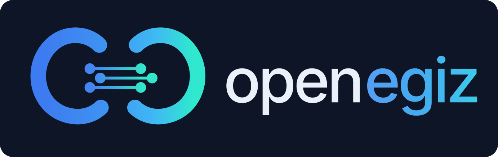

# Все требования и условия конкурса «Цифровой рудник на OpenEgiz»

Составлено 20 октября 2026 года по скачанным репозиториям `openegiz-contest.github.io`, `team-050` и шаблону `template`. Перед сборкой выполнен `git fetch origin`: в репозиториях сайта и team-050 новых коммитов относительно `origin/main` не обнаружено.

Зафиксированные версии: сайт — `c5ce54aa89ae2651b7cf07f5a48a523f87e17ee1`; team-050 — `e6c692a5f27d9ce9abcaf63195b8bf6b2b109ee7`. Редакция Положения — 12 октября 2026 года.

Это единый сборник: сначала практическая сводка, затем полные тексты основных конкурсных страниц и исходные требования командного шаблона. При расхождении сводки и Положения действует русский текст Положения. Официальные разъяснения публикуются организатором в GitHub Discussions. Отдельный просмотр всех обсуждений и открытых pull request в этот сборник не входит; он отражает содержимое указанных версий репозиториев.

## Содержание

1. Задача и обязательные свойства решения.
2. Сдаваемые файлы и документация.
3. Запуск и окружение судьи.
4. Оценка и ограничения баллов.
5. Данные и лицензии.
6. Участие, сроки, финал и приз.
7. Технические сведения платформы и текущее состояние team-050.
8. Контрольный список сдачи.
9. Приложения: полные тексты правил, окружения, карты модулей, данных, FAQ и документов шаблона.

## 1. Задача и обязательные свойства решения

Источники: Положение, пункты 6.1–6.13, 9.1–9.4; Карта рудника; AGENTS.md.

- Создать собственный цифровой рудник на OpenEgiz: карьер, подземную шахту, обогатительную фабрику либо часть горнорудного предприятия.
- Объекты должны быть двойниками Eclipse Ditto; данные должны проходить через платформу по цепочке MQTT → Ditto; интерфейс должен получать данные из платформы. Формальное подключение отдельного приложения недостаточно.
- Разработка ведётся в репозитории команды. Разрешено менять любые части, включая ядро OpenEgiz; папка `team/` необязательна.
- До разработки команда сама формулирует замысел в первом разделе `SUBMISSION.md`: предприятие/участок, пользователь, принимаемое решение, причина выбора, реальность объекта и источники числовых значений. Для вымышленного объекта — реальные аналоги и происхождение параметров.
- Инструкция AGENTS.md требует от ИИ дождаться ответов команды на вопросы замысла; ИИ не должен самостоятельно придумывать замысел, начинать код, каркас или план реализации до его появления.
- Пример `examples/mine` демонстрирует устройство платформы. Неизменённые части примера баллов не приносят. Решение команды должно следовать собственному замыслу.
- Состав модулей выбирает команда; глубина важнее количества. Допускаются модули вне опубликованной карты на равных условиях.
- Для каждого модуля: назначение и способ увидеть работу на стенде. Для каждого сценария «что если»: действие, способ запуска/проверки и способ отмены. Учитывается подтверждённая работа.
- Для критерия визуализации требуется пространственное представление рудника с данными двойников и процессами: карта, анимированная схема или 3D. Одни графики и таблицы этот критерий не закрывают. 3D и Unity не обязательны.
- Для баллов за сценарии «что если» они запускаются на стенде без изменения кода; последствия должны распространяться по связанным двойникам и отображаться в визуализации. Правила не устанавливают обязательного количества сценариев или модулей.
- Допустимы русский, казахский или английский языки; любые инструменты разработки, включая ИИ.

Предлагаемые направления карты: транспорт и диспетчеризация; геология и качество руды; буровзрывные работы; вентиляция и безопасность; энергетика; дробление/измельчение/флотация; ТО и надёжность. Визуализация и дашборды сами по себе модулями не считаются.

## 2. Сдаваемые файлы и документация

Источник: Положение, пункты 6.4–6.5, 6.11–6.13; README.md и SUBMISSION.md шаблона.

| Файл в корне | Что требуется |
|---|---|
| `README.md` | Полная инструкция установки и запуска с нуля, включая необходимые пакеты, загрузку данных/моделей и сборку; без ручного вмешательства |
| `SUBMISSION.md` | Описание по форме шаблона, начиная с замысла; команда, рудник, модули/сценарии, работоспособность, данные/допущения, визуализация, ограничения и презентация |
| `presentation.pdf` | Презентация выполненной работы, соответствующая работающему стенду |

Видео необязательно: ссылка в `SUBMISSION.md`. Решение распространяется по MIT; сторонний код и данные сохраняют свои лицензии. Шаблон README предлагает добавить сведения об авторских правах команды в `LICENSE`.

Поля SUBMISSION.md:

1. **Concept:** предприятие, пользователи, решение, обоснование выбора, реальный/вымышленный объект и источники.
2. **Team:** GitHub-имена участников; другие персональные сведения не требуются.
3. **Mine:** часть предприятия, объекты-двойники, связи, места определения в коде.
4. **Modules and What-if Scenarios:** что делает функция, как увидеть её на стенде и как отменить сценарий.
5. **What works and what does not:** проверенное, незавершённое, известные ошибки.
6. **Data and Assumptions:** синтетические/реальные данные, источники параметров, лицензии и доставка наборов данных.
7. **Mine visualization:** адрес интерфейса/дашборда/сцены и что он показывает.
8. **Limitations:** ограничения.
9. **Presentation:** `presentation.pdf`, при желании ссылка на видео.

Не установлены отдельные обязательные числа слайдов, страниц презентации, двойников или модулей. Нельзя выдавать предложенный состав за дополнительное требование организатора.

## 3. Запуск и окружение судьи

Источники: Положение, пункт 6.4; страница «Окружение судьи».

| Параметр | Условия оценки |
|---|---|
| Машина | Отдельная KVM VM для каждого решения; уничтожается после оценки |
| Архитектура | amd64 / x86-64 |
| CPU | 8 vCPU |
| RAM | 16 ГиБ |
| Диск | 60 ГБ, около 55 ГБ свободно |
| ОС | Ubuntu 24.04.5 LTS cloud image, ядро 6.8 |
| Docker | Engine 29.1.3; Compose 2.40.3; Buildx 0.30.1 |
| ПО | Только стандартный состав cloud image (`git`, `curl`, `python3` и др.) и Docker; `make` отсутствует |
| Пользователь | `judge`, группа `docker`, sudo без пароля |
| Лимит запуска | 75 минут |
| Интернет | Доступен для образов, пакетов, моделей и данных |
| Сеть | Закрыты локальная сеть, хост, другие VM и частные адреса; IPv6 отключён |
| Локальные сервисы | `localhost` / `127.0.0.1`, открываются браузером судьи |
| Графика | WebGL и Unity поддерживаются; GPU нет |

- README исполняется буквально, команды — последовательно; требование «ровно одна команда» отсутствует.
- Упавший шаг повторяется один раз без изменений; засчитывается последняя попытка.
- Нет ключей, платных сервисов и аккаунтов организатора, данных других команд и ваших локальных настроек.
- Все необходимые инструменты и зависимости должны устанавливаться инструкцией; нельзя рассчитывать на заранее загруженные образы, файлы вне репозитория или переменные вашей машины.
- Если обязательный внешний набор данных не загрузился, решение считается не запустившимся.
- Внешние ресурсы интерфейса разрешены, но их недоступность может сломать оценку. Организатор рекомендует включать критичные файлы в решение и уменьшать тяжесть 3D-сцен.

## 4. Оценка

Источник: Положение, разделы 8–10.

| Критерий | Максимум | Что оценивается |
|---|---:|---|
| Модель рудника | 25 | Типы объектов, состояния, связи, полнота двойников |
| Визуализация рудника | 25 | Пространственная модель, данные двойников, процессы, последствия сценариев |
| Достоверность поведения | 20 | Правдоподобные и согласованные величины, взаимосвязи процессов, реальные ограничения |
| Замысел и презентация | 15 | Обоснованная задача производства, согласованность замысла и реализации; реальный объект с источниками оценивается выше |
| Сценарии «что если» | 10 | Запуск без правки кода, распространение последствий по двойникам и отображение |
| Модули | 5 | Рабочие функции, меняющие работу рудника или формирующие новое решение |
| **Итого** | **100** | |

Каждый судья назначает по критерию уровень 0–4; баллы = максимум критерия × уровень / 4. Итог отбора — среднее арифметическое оценок судей. В опубликованной таблице нет подробных отдельных определений каждого уровня 0–4.

Учитывается созданное командой и подтверждённое судьёй на стенде или в исходном коде. Неподтверждённые заявления документов баллов не дают. Неизменённые части примера не оцениваются. Типовое решение, созданное агентами без замысла, служит нижней точкой отсчёта; сходный результат получает низкие уровни по модели, визуализации и замыслу/презентации.

Если решение не запустилось по README или не построено на OpenEgiz — **не более 40 баллов**, победить нельзя. Если ни одно решение не набрало больше 40, приз не присуждается.

Сборщик запускает проект и пишет отчёт, баллов не выставляет. Судьи независимо изучают отчёт, код, SUBMISSION.md, презентацию и интерфейс. Состав жюри и хеш пайплайна публикуются до заморозки; промпты, код пайплайна, оценки, обоснования и журналы — после отбора. Детали доступности судей и исправлений пайплайна приведены в полном Положении ниже.

## 5. Данные и лицензии

Источники: Положение, пункты 6.6, 6.8–6.11; страница «Данные».

- Синтетические данные и моделирование допустимы, параметры нужно обосновать.
- Открытые наборы данных допустимы; для размещения копий в репозитории нужна разрешающая это лицензия.
- Для внешней загрузки команда отвечает за доступность; источник и лицензия указываются в README или рядом с данными.
- Конфиденциальные данные организаций и персональные данные запрещены.
- В SUBMISSION.md перечисляются реальные/синтетические данные, источники параметров, лицензии.
- CC BY требует автора, название, источник, ссылку на лицензию и указание изменений; рекомендовано `data/<набор>/README.md` или `DATA_LICENSES.md` со ссылкой из SUBMISSION.md.
- MIT кода не заменяет лицензию данных. Для CC BY-SA изменённые данные распространяются на тех же условиях.
- Список рекомендованных наборов не обязателен и не снимает ответственности команды. Полная таблица со ссылками включена в приложение.

## 6. Участие, сроки, финал и приз

Источники: Положение, разделы 1–5, 7, 10–15.

- Команда: 1–4 физических лица. Несовершеннолетние — с согласием законного представителя. Один участник может состоять только в одной команде.
- Регистрация через форму: название, ФИО, место учёбы/работы, email и GitHub каждого участника; согласия с правилами, возрастом/представителем, MIT, распределением приза, обработкой и трансграничной передачей данных.
- Организатор создаёт `openegiz-contest/team-NNN`, приглашает участников с правом записи без изменения настроек/удаления репозитория.
- Состав меняется через «Изменить ответ» до заморозки. Дубли GitHub/email относятся к ранее зарегистрированной команде. После закрытия состав фиксирован.

Все сроки ниже — **время Астаны, UTC+5**.

| Срок | Событие |
|---|---|
| 25 октября 2026, 23:59 | Заморозка и закрытие регистрации |
| 26–28 октября 2026 | Отбор |
| Не позднее 28 октября, 12:00 | Публикация отчётов |
| 48 часов от фактической публикации отчётов | Апелляции |
| 31 октября 2026 | Финал на YouTube |
| 72 часа после объявления результатов | Подтверждение участия победителем |
| До 30 ноября 2026 | Выступление победителя очно или онлайн |
| До 30 дней после выступления | Выплата приза |

В момент заморозки фиксируется последний коммит `main`, запись отзывается, репозиторий и история становятся публичными для чтения. Другие ветки, PR и поздние изменения не оцениваются. Если `main` не отличается от шаблона, решение считается не поданным.

В финал проходят 10 лучших с учётом апелляций, либо все, если решений меньше десяти. Места 1–3 определяют судьи большинством. Если после предельного числа раундов большинства нет: балл отбора → средний балл модели рудника → более ранняя регистрация. Полный порядок и случай недоступности судьи приведены ниже.

Дисквалификация: инструкции в коде, данных, README, презентации или UI, адресованные сборщику/судьям для изменения их поведения или оценок (prompt injection). Промпты собственных функций ИИ и указания людям под этот запрет сами по себе не подпадают. Нарушение устанавливает отдельный агент, заключение публикуется.

Апелляция допускается на фактическую ошибку отчёта сборки или заключение о вмешательстве в жюри; несогласие с баллами недостаточно. Автоматический повторный запуск и отдельный судья; при удовлетворении новая оценка не может быть ниже старой. Порядок подачи объявляется с отчётами.

Приз победителю — 1 000 000 ₸, поровну между участниками состава на закрытие регистрации. Выплата долями наличными либо на личные счета. Налоги, сборы и комиссии — по правилам пункта 3.6 полного Положения. Второе и третье места: дипломы, предложение стажировки/работы DigitalEgiz, публикация решений; денежного приза нет.

Победитель подтверждает участие письмом `developerbeck@digitalegiz.kz` или сообщением участника в Discussions. Без подтверждения победителем становится следующая команда. Выступление до 30 ноября — условие выплаты, не распределения мест. Если оно не состоялось по независимым от победителя причинам, условие считается выполненным; в этом случае выплата до 30 декабря 2026. Задержка предоставления банковских реквизитов продлевает выплату соответствующей доли.

Русское Положение имеет приоритет над переводами; FAQ его не заменяет. Официальны ответы организатора в Discussions. Рубрика от 12 октября и правило последнего слова больше не меняются; состав жюри — после публикации. Прочие изменения не должны ухудшать положение зарегистрированных участников; сроки могут переноситься только позже.

Публикуются название команды, GitHub участников и после заморозки весь репозиторий с историей. Регистрационные/платёжные сведения организатор хранит с ограниченным доступом и удаляет не позднее 30 апреля 2027; для проведения конкурса данные передаются Google, GitHub и поставщикам моделей жюри в объёмах, описанных в разделе 15.

## 7. Платформа и состояние team-050

Источники: OPENEGIZ.ru.md, README.md, Makefile, SUBMISSION.md, team/README.md, examples/mine, docs/README.md.

Платформа в шаблоне — OpenEgiz v1.0.4. Локально рекомендованы Docker Compose 2.20+, git, make и около 6 ГБ памяти Docker; Windows — WSL2. Это требования локального быстрого старта, а параметры судьи выше — 16 ГиБ RAM и фиксированные версии.

Основной путь — Docker Compose. Helm/k3s — альтернативный серверный путь; документация ARM64, Hermes, JaamSim, pm4py, печи и прочие примеры не создают обязанности внедрять эти технологии в конкурсное решение.

Иерархия двойников задаётся `_parents`; телеметрия использует Ditto protocol и MQTT `telemetry/<двойник>`; InfluxDB хранит историю через Telegraf; Grafana отображает двойники/дашборды. Прикладной сервис команды может входить в Compose и работать через MQTT или Ditto API.

Команды шаблона: `make up` — платформа; `make example-mine` — демонстрация; `make smoke` — проверка; `make ps`/`make logs S=<сервис>` — состояние/логи; `make down` — остановка с данными; `make clean` — удаление данных и паролей. Пароли генерируются в `deploy/compose/.env`, по умолчанию их нет. Эти команды не являются готовой инструкцией сдачи собственного решения: README нужно адаптировать.

При просмотре скачанной Windows-копии team-050: README ещё содержит шаблон `<Team name>`, Concept и остальные разделы SUBMISSION.md не заполнены, `presentation.pdf` в корне отсутствует. Запущенный ранее Example Mine — демонстрация платформы. Сам факт запуска примера не подтверждает выполнение конкурсного задания. Состояние Linux-копии и незакоммиченные изменения на GitHub этим утверждением не оцениваются.

## 8. Контрольный список перед сдачей

Это рабочая сводка правил, а не дополнительные требования организатора.

- [ ] Состав команды и приглашения GitHub оформлены; нет участия в двух командах.
- [ ] Команда сама написала Concept до разработки.
- [ ] Создана собственная модель с Ditto-двойниками и связями; MQTT действительно обновляет платформу, UI читает её данные.
- [ ] Параметры и поведение объяснены источниками/допущениями.
- [ ] Для визуализации есть карта, схема или сцена с состояниями объектов и процессов.
- [ ] Все заявленные модули и сценарии воспроизводятся; описаны проверка и отмена сценариев.
- [ ] README содержит весь путь с чистой машины, зависимости, данные, сборку, запуск и адреса интерфейсов.
- [ ] Проверено соответствие окружению судьи и лимиту 75 минут.
- [ ] Все разделы SUBMISSION.md заполнены, известные ограничения указаны.
- [ ] `presentation.pdf` находится в корне и соответствует стенду.
- [ ] Лицензии кода и данных соблюдены, источники и изменения указаны; запрещённых данных нет.
- [ ] Нет указаний, направленных на изменение работы сборщика/жюри.
- [ ] Все сдаваемые изменения находятся в `main` до 25 октября, 23:59 UTC+5; ветка отличается от шаблона.
- [ ] Проверены актуальные официальные разъяснения, обновления организатора и опубликованные сведения о жюри до заморозки.

## 9. Полные исходные материалы

Ниже автоматически перенесён основной текст русских конкурсных страниц с сохранением ссылок. Навигация и подвал сайта исключены. Затем приведены документы шаблона. Эти приложения позволяют сверить сводку с полными условиями, включая формулировки, не вынесенные в краткий список.


## А. Полное Положение

Источник: [https://openegiz-contest.github.io/ru/rules/](https://openegiz-contest.github.io/ru/rules/); файл `openegiz-contest.github.io/ru/rules/index.html`.

### Положение о конкурсе «Цифровой рудник на OpenEgiz»


Редакция от 12 октября 2026 г. Изменения по сравнению с предыдущей редакцией:


- раздел 2: добавлены термины «Замысел» и «Типовое Решение»; 
- пункт 6.5: `SUBMISSION.md` начинается с Замысла; добавлен пункт 6.13 о Замысле; 
- пункт 9.1: критерий «Презентация» (10 баллов) заменён критерием «Замысел и презентация» (15 баллов); изменены веса критериев: Визуализация рудника — 25 баллов (было 20), Сценарии «что если» — 10 баллов (было 15), Модули — 5 баллов (было 10); 
- добавлен пункт 9.4 о Типовом Решении; 
- пункт 10.2: в Финале Судьи учитывают продуманность Замысла; 
- пункт 14.2: Рубрика в настоящей редакции и Правило последнего слова в дальнейшем не изменяются. 


#### 1. Общие положения


1.1. Настоящее Положение определяет порядок проведения открытого конкурса «Цифровой рудник на OpenEgiz» (далее — конкурс). Предмет конкурса — создание цифрового двойника рудника на платформе OpenEgiz.


1.2. Организатор конкурса — физическое лицо Амирханова Гульшат Аманжоловна (далее — Организатор). Организатор проводит конкурс от своего имени, утверждает Положение, публикует Официальные разъяснения и выплачивает приз из личных средств. Конкурс проводится при поддержке лаборатории DigitalEgiz КазНУ им. аль-Фараби.


1.3. Места в конкурсе определяет ИИ-жюри по Рубрике и пайплайну ИИ-жюри, зафиксированным до Заморозки (пункт 8.5). Организатор и иные лица в определении мест не участвуют.


1.4. Правила конкурса устанавливаются настоящим Положением. Официальные разъяснения толкуют Положение и не изменяют его. Положение публикуется на английском, казахском и русском языках; при расхождении текстов преимущественную силу имеет текст на русском языке.


1.5. Официальные ресурсы конкурса:


- сайт конкурса — openegiz-contest.github.io; 
- организация конкурса на GitHub — `openegiz-contest`; 
- GitHub Discussions конкурса — вопросы и Официальные разъяснения; 
- Instagram `digital_twin_kaznu` — объявления. 


1.6. Все сроки указаны по времени Астаны (UTC+5).


#### 2. Термины


- **Апелляция** — заявление Команды о фактической ошибке в Отчёте сборки или в заключении о попытке повлиять на ИИ-жюри (раздел 12). 
- **Заморозка** — момент окончания приёма Решений, после которого Репозитории команд доступны только для чтения (пункт 7.1). 
- **Замысел** — первый раздел `SUBMISSION.md`, в котором Команда сама указывает предприятие или его часть, кто пользуется цифровым двойником и какое решение он помогает принять (пункт 6.13). 
- **ИИ-жюри** — совокупность Судей. 
- **Карта рудника** — опубликованный на сайте конкурса перечень Модулей цифрового рудника. 
- **Команда** — группа из одного–четырёх Участников, представляющая одно Решение. 
- **Модуль** — функциональное направление цифрового рудника (например, транспорт и диспетчеризация, вентиляция). 
- **Окружение судьи** — эталонная вычислительная среда, в которой запускается каждое Решение. Её характеристики публикуются на сайте конкурса. 
- **Организатор** — Амирханова Гульшат Аманжоловна (пункт 1.2). 
- **Отборочный этап** — оценка всех Решений всеми Судьями, предшествующая Финалу. 
- **Отчёт сборки** — составляемый Сборщиком отчёт о запуске Решения: результаты выполнения инструкции, работоспособность заявленных функций, журналы. 
- **Официальное разъяснение** — ответ Организатора в GitHub Discussions конкурса, толкующий Положение (пункт 14.1). 
- **Победитель** — Команда, занявшая первое место. 
- **Правило последнего слова** — порядок присуждения места при отсутствии большинства голосов Судей (пункт 10.4). 
- **Призёры** — Команды, занявшие второе и третье места. 
- **Пример рудника** — демонстрационный цифровой рудник в составе OpenEgiz (`examples/mine`), показывающий устройство цифрового рудника на платформе. Пример рудника не является Решением и не является обязательной основой для него. 
- **Регистрация** — подача заявки Команды через форму на сайте конкурса (раздел 5). 
- **Репозиторий команды** — приватный репозиторий Команды в организации `openegiz-contest` на GitHub, созданный из Шаблона. 
- **Решение** — содержимое ветки `main` Репозитория команды на момент Заморозки. 
- **Рубрика** — критерии и веса, по которым Судьи выставляют баллы (раздел 9). 
- **Сборщик** — агент ИИ, запускающий Решение по инструкции README и составляющий Отчёт сборки. Сборщик баллов не выставляет. 
- **Стенд** — запущенный в Окружении судьи экземпляр OpenEgiz с Решением. 
- **Судья** — модель ИИ, работающая в агенте и выставляющая баллы по Рубрике независимо от других Судей. 
- **Сценарий «что если»** — изменение условия работы рудника на Стенде (например, закрытие дороги или остановка техники), последствия которого отражаются в данных двойников. 
- **Типовое Решение** — цифровой рудник, созданный из Шаблона агентами ИИ без Замысла Команды; Организатор публикует его на сайте конкурса как точку отсчёта для Судей (пункт 9.4). 
- **Участник** — физическое лицо, зарегистрированное в составе Команды. 
- **Финал** — заключительный этап конкурса в прямом эфире, на котором Судьи определяют места с первого по третье. 
- **Финалисты** — Команды, Решения которых вышли в Финал (пункт 10.1). 
- **Шаблон** — полная копия OpenEgiz зафиксированного для конкурса выпуска, из которой создаются Репозитории команд. 
- **OpenEgiz** — открытая платформа для цифровых двойников (`github.com/aleka07/openegiz`). 


#### 3. Приз


3.1. Победителю присуждается приз в размере **1 000 000 (одного миллиона) тенге**.


3.2. Если Команда-Победитель состоит из нескольких Участников, приз делится между ними поровну. Доли получают Участники, входящие в состав Команды на момент закрытия Регистрации. Согласие с таким порядком Участники подтверждают при Регистрации.


3.3. Приз выплачивается каждому Участнику в размере его доли в тенге наличными или переводом на личный банковский счёт Участника.


3.4. Призёры награждаются дипломами и получают предложение стажировки или работы в лаборатории DigitalEgiz; их Решения публикуются на сайте OpenEgiz. Денежный приз Призёрам не выплачивается.


3.5. Приз не присуждается, если ни одно Решение не набрало более 40 баллов (пункт 9.3).


3.6. Приз выплачивается без удержания налогов, если законодательство Республики Казахстан не обязывает Организатора удержать налог при выплате. Налоги, сборы, банковские комиссии и иные расходы, связанные с получением приза, Участник несёт самостоятельно в соответствии с законодательством страны своего налогового резидентства.


3.7. Срок и порядок выплаты приза установлены пунктом 13.3.


#### 4. Участники


4.1. Участником конкурса может стать любое физическое лицо. Лицо, не достигшее 18 лет, участвует с согласия своего законного представителя.


4.2. Участник может входить в состав только одной Команды.


4.3. При создании Решения допускается использование любых инструментов, включая средства искусственного интеллекта.


#### 5. Регистрация


5.1. Команда регистрируется через форму, размещённую на сайте конкурса. В форме указываются название Команды и для каждого Участника — фамилия, имя, отчество, место учёбы или работы, адрес электронной почты и имя пользователя GitHub.


5.2. При Регистрации каждый Участник подтверждает:


- согласие с настоящим Положением; 
- достижение 18 лет либо согласие законного представителя (пункт 4.1); 
- согласие на распространение Решения по лицензии MIT и право распространять на этих условиях свой вклад в Решение (пункт 6.6); 
- согласие с порядком деления и выплаты приза (пункты 3.2 и 3.6); 
- согласие на обработку персональных данных, включая их передачу за пределы Республики Казахстан (раздел 15). 


5.3. После Регистрации для Команды создаётся Репозиторий команды `openegiz-contest/team-NNN`, где NNN — порядковый номер Регистрации, а Участникам направляются приглашения на GitHub. Участники получают право записи в Репозиторий команды без права изменять его настройки и удалять его.


5.4. До закрытия Регистрации состав Команды изменяется с помощью функции «Изменить ответ» формы регистрации. Если один и тот же аккаунт GitHub или адрес электронной почты указан в составе двух Команд, лицо включается в состав Команды, зарегистрированной ранее.


5.5. Регистрация закрывается в момент Заморозки. После закрытия Регистрации состав Команд не изменяется.


#### 6. Задание и Решение


6.1. Задание конкурса — создать собственный цифровой рудник на платформе OpenEgiz. Цифровой рудник может представлять любую часть горнорудного предприятия, в том числе карьер, шахту, обогатительную фабрику. Треки и номинации не предусмотрены. Состав Модулей Команда определяет самостоятельно, руководствуясь Картой рудника; Модули, не включённые в Карту рудника, оцениваются наравне с ними. Глубина проработки Модулей имеет приоритет над их количеством.


6.2. Решение должно быть построено на OpenEgiz. Это означает, что:


- объекты рудника представлены двойниками в Eclipse Ditto; 
- данные передаются через платформу (MQTT → Ditto); 
- пользовательский интерфейс получает данные из платформы. 


Приложение, работающее отдельно от платформы и подключённое к ней формально, построенным на OpenEgiz не считается (пункт 9.3).


6.3. Работа ведётся в Репозитории команды. Допускается изменение любых частей, включая ядро платформы. Пример рудника демонстрирует устройство цифрового рудника на платформе; его использование не обязательно. Оценивается только то, что создано Командой (пункт 9.1).


6.4. Решение должно запускаться по инструкции `README.md` без ручного вмешательства в Окружении судьи. Сборщик выполняет инструкцию буквально; Решение, не запущенное по инструкции, считается не запустившимся. Шаг инструкции, завершившийся ошибкой, повторяется один раз без изменений; учитывается результат последней попытки. Характеристики Окружения судьи, включая ограничение времени запуска, публикуются на сайте конкурса. В Окружении судьи отсутствуют ключи доступа, платные сервисы и учётные записи Организатора.


6.5. Решение должно содержать в корне репозитория:


- `README.md` — инструкцию по установке и запуску Решения с нуля; 
- `SUBMISSION.md` — описание Решения по форме из Шаблона: Замысел (пункт 6.13), состав Команды (имена пользователей GitHub), реализованные Модули, их работоспособность и ограничения, раздел «Данные и допущения», указание на визуализацию; 
- `presentation.pdf` — презентацию Решения. 


Видеоролик предоставляется по желанию Команды в виде ссылки в `SUBMISSION.md`.


6.6. Решение распространяется по лицензии **MIT**. Авторские права принадлежат Команде; Команда вправе указать себя в файле `LICENSE`. Каждый Участник распространяет свой вклад в Решение на условиях лицензии MIT и подтверждает при Регистрации, что вправе это делать. Код OpenEgiz, входящий в Шаблон, а также сторонние программы и данные в составе Решения распространяются на условиях собственных лицензий. Материалы, лицензия которых не допускает их публикацию, в Репозиторий команды не включаются.


6.7. Решения принимаются на казахском, русском или английском языке.


##### Данные


6.8. Допускается использование синтетических данных и моделирования при условии обоснования параметров.


6.9. Допускается использование открытых наборов данных. Набор данных, размещённый в Репозитории команды, должен иметь лицензию, разрешающую распространение копий. За доступность набора данных, загружаемого из внешнего источника по инструкции `README.md`, отвечает Команда; если набор данных не загружен, Решение считается не запустившимся. Лицензия и источник набора данных указываются в `README.md` или рядом с данными.


6.10. Запрещается использование конфиденциальных данных организаций и персональных данных. Ответственность за правомерность использования данных несёт Команда.


6.11. `SUBMISSION.md` должен содержать раздел «Данные и допущения» с указанием синтетических и реальных данных, источников параметров (паспорта техники, справочная литература, нормативы, наборы данных) и лицензий наборов данных.


6.12. Для каждого Модуля и Сценария «что если» в `SUBMISSION.md` указывается, что он делает и как увидеть его работу на Стенде; для Сценария «что если» — также способ его отмены. Учитываются только Модули и Сценарии «что если», работа которых подтверждена на Стенде.


6.13. Первый раздел `SUBMISSION.md` — Замысел, который составляет сама Команда. В Замысле указываются предприятие или его часть, представленные Решением, кто пользуется цифровым двойником, какое решение он помогает принять и почему сделан именно такой выбор. Объект может быть реальным или вымышленным; для вымышленного объекта указывается, на какие реальные объекты он похож и откуда взяты его числовые значения.


#### 7. Сроки


| Дата | Этап |
| --- | --- |
| день первой публикации Положения | начало конкурса, открытие Регистрации |
| 25 октября 2026 г., 23:59 | Заморозка, закрытие Регистрации |
| 26–28 октября 2026 г. | Отборочный этап |
| не позднее 28 октября 2026 г., 12:00 | публикация отчётов Отборочного этапа |
| 48 часов после публикации отчётов | подача Апелляций; затем рассмотрение Апелляций и определение Финалистов |
| 31 октября 2026 г. | Финал в прямом эфире на YouTube |
| в течение 72 часов после Финала | подтверждение участия Победителем |
| не позднее 30 ноября 2026 г. | выступление Победителя |
| не позднее 30 дней после выступления | выплата приза (пункт 13.3) |


7.1. В момент Заморозки право записи Участников отзывается, фиксируется последний коммит ветки `main` каждого Репозитория команды, после чего репозитории переводятся в публичный доступ только для чтения. Решением считается зафиксированный коммит. Иные ветки, запросы на слияние (pull request) и изменения после Заморозки не рассматриваются. Перечень зафиксированных коммитов публикуется.


7.2. Решение, ветка `main` которого не отличается от Шаблона, считается не поданным.


#### 8. ИИ-жюри


8.1. Состав ИИ-жюри публикуется до Заморозки (пункт 8.5).


8.2. Оценка Решения проводится в два этапа:


- Сборщик запускает Решение по инструкции `README.md` в изолированном Окружении судьи и составляет Отчёт сборки. 
- Судьи независимо друг от друга выставляют баллы по Рубрике на основании Отчёта сборки, исходного кода, `SUBMISSION.md`, презентации и пользовательского интерфейса Стенда. 


8.3. На Отборочном этапе каждое Решение оценивается всеми Судьями. Отчёты сборки, оценки Судей с обоснованиями и журналы работы публикуются.


8.4. Если технические ограничения сервисов ИИ не позволяют Судье до публикации отчётов Отборочного этапа оценить все Решения, оценённые остальными Судьями, оценки этого Судьи на Отборочном этапе не учитываются. Дата Финала не переносится.


8.5. Рубрика является частью настоящего Положения. Пайплайн ИИ-жюри (промпты Судей и программный код) фиксируется до Заморозки. До Заморозки публикуются состав ИИ-жюри и контрольная сумма (хеш) зафиксированной версии пайплайна; после публикации результатов Отборочного этапа публикуются промпты Судей и программный код пайплайна, по которым контрольная сумма может быть проверена. После фиксации пайплайн не изменяется, за исключением исправления ошибок, не влияющих на оценку. О каждом таком исправлении публикуется сообщение с обоснованием и новой контрольной суммой.


#### 9. Рубрика


9.1. Каждый Судья оценивает Решение по шкале от 0 до 100 баллов по следующим критериям. По каждому критерию Судья определяет уровень от 0 до 4; балл по критерию равен произведению наибольшего балла критерия на уровень, делённому на 4. Учитывается только то, что создано Командой и подтверждено Судьёй на Стенде или в исходном коде; утверждения `SUBMISSION.md` и презентации, не подтверждённые на Стенде, баллов не приносят. Пример рудника и его части, использованные без изменений, баллов не приносят.


| Критерий | Баллы | Содержание |
| --- | --- | --- |
| Модель рудника | 25 | Полнота представления рудника двойниками в OpenEgiz: типы объектов, их состояния и связи между ними |
| Визуализация рудника | 25 | Рудник представлен на Стенде как пространственный объект, отображающий данные двойников, ход технологических процессов и последствия Сценариев «что если», а не только графиками и таблицами. Технология не ограничивается |
| Достоверность поведения | 20 | Состояние двойников изменяется так, как на реальном горном производстве: величины правдоподобны и согласованы между собой, процессы взаимосвязаны, учтены реальные ограничения |
| Замысел и презентация | 15 | Продуманность Замысла (пункт 6.13): задача существует на реальном горном производстве, выбор обоснован, модель рудника, визуализация и Сценарии «что если» вытекают из Замысла; реальный объект с указанием источников цифр оценивается выше. `presentation.pdf` ясно излагает выполненную работу и способ увидеть её на Стенде; изложенное соответствует Стенду |
| Сценарии «что если» | 10 | Сценарии «что если», запускаемые на Стенде без изменения кода; их последствия распространяются по связанным двойникам и отображаются в визуализации (пункт 6.12) |
| Модули | 5 | Модули, работающие на Стенде (пункт 6.12). Модуль учитывается, если он изменяет работу рудника или формирует решение, которое без него отсутствует |


9.2. Балл Решения на Отборочном этапе — среднее арифметическое баллов Судей.


9.3. Балл Решения, не запустившегося по `README.md` или не построенного на OpenEgiz (пункт 6.2), не может превышать 40 баллов. Такое Решение не может стать Победителем.


9.4. Организатор публикует на сайте конкурса Типовое Решение. Судьи используют Типовое Решение как точку отсчёта при определении уровней. Решение, не выходящее за пределы Типового Решения, получает низкие уровни по критериям «Модель рудника», «Визуализация рудника» и «Замысел и презентация».


#### 10. Финал и определение мест


10.1. В Финал выходят 10 Решений с наибольшим баллом Отборочного этапа с учётом результатов рассмотрения Апелляций. Если Решений меньше десяти, в Финал выходят все Решения.


10.2. Финал проводится в прямом эфире на YouTube. Судьи обсуждают Решения Финалистов и определяют места с первого по третье. При обсуждении Судьи учитывают продуманность собственного Замысла Команды, принимая Типовое Решение за точку отсчёта. Журналы обсуждения публикуются.


10.3. Места присуждаются последовательно, начиная с первого. Место присуждается Финалисту, за которого проголосовало более половины Судей. При отсутствии большинства проводится следующий раунд обсуждения. Предельное число раундов публикуется вместе с пайплайном ИИ-жюри.


10.4. **Правило последнего слова.** Если после последнего раунда большинство не достигнуто, место присуждается Финалисту с наибольшим баллом Отборочного этапа из числа ещё не получивших место. При равенстве баллов место присуждается Финалисту с наибольшим средним баллом по критерию «Модель рудника», а при сохранении равенства — Команде, зарегистрированной ранее.


10.5. Если Судья недоступен во время Финала, решение принимается большинством голосов остальных Судей; при равенстве голосов применяется Правило последнего слова.


#### 11. Дисквалификация


11.1. Решение дисквалифицируется за попытку повлиять на ИИ-жюри — размещение в инструкции, коде, данных, презентации или интерфейсе скрытых или явных указаний, адресованных Сборщику или Судьям и направленных на изменение их работы или оценки (prompt injection). Указания, адресованные людям, и промпты функций Решения, адресованные его собственным моделям ИИ, попыткой повлиять на ИИ-жюри не являются.


11.2. Наличие таких указаний устанавливает отдельный агент ИИ. Его заключение публикуется вместе с отчётами Отборочного этапа и может быть обжаловано в порядке, установленном разделом 12.


#### 12. Апелляции


12.1. Команда вправе подать Апелляцию в течение **48 часов** после публикации отчётов Отборочного этапа. Отчёты публикуются не позднее 28 октября 2026 г., 12:00. Порядок подачи объявляется одновременно с публикацией отчётов. Финалисты определяются после рассмотрения всех Апелляций, поданных в срок.


12.2. Апелляция принимается только в отношении фактической ошибки Отчёта сборки или заключения о попытке повлиять на ИИ-жюри — например, если Отчёт сборки указывает, что Модуль не запускается, а Команда представляет журнал, подтверждающий его запуск. Несогласие с выставленными баллами основанием для Апелляции не является.


12.3. Апелляция рассматривается автоматически: Решение запускается повторно, спор разрешает отдельный Судья. При удовлетворении Апелляции Судьи повторно оценивают Решение по исправленному Отчёту сборки; итоговый балл при этом не может быть снижен. Результат рассмотрения публикуется и является окончательным.


12.4. Порядок, установленный настоящим разделом, не ограничивает право Участника на защиту своих прав в порядке, установленном законодательством Республики Казахстан.


#### 13. Победитель


13.1. Победитель подтверждает участие в течение **72 часов** после объявления результатов письмом на адрес developerbeck@digitalegiz.kz или сообщением в GitHub Discussions конкурса от любого Участника Команды. При отсутствии подтверждения Победителем признаётся Команда, следующая в итоговом рейтинге Финала.


13.2. Условием получения приза является выступление Победителя. Выступление на распределение мест не влияет и проводится очно в КазНУ им. аль-Фараби или онлайн по выбору Победителя, в согласованное с Организатором время, не позднее 30 ноября 2026 г. Если выступление не состоялось в этот срок по причинам, не зависящим от Победителя, условие выступления считается выполненным.


13.3. Приз выплачивается не позднее 30 дней после выступления Победителя, а если условие выступления считается выполненным по пункту 13.2 — не позднее 30 декабря 2026 г. Для выплаты каждый Участник Команды-Победителя сообщает Организатору фамилию, имя, отчество и реквизиты банковского счёта либо получает свою долю наличными (пункт 3.3). Срок выплаты доли Участника, не сообщившего реквизиты, продлевается на время задержки.


#### 14. Вопросы и изменения Положения


14.1. Вопросы о конкурсе задаются в GitHub Discussions конкурса. Ответы Организатора в GitHub Discussions являются Официальными разъяснениями. Ответы в иных каналах официальными не являются.


14.2. Рубрика в редакции от 12 октября 2026 г. и Правило последнего слова в дальнейшем не изменяются; состав ИИ-жюри не изменяется после его публикации. Иные изменения Положения публикуются на сайте конкурса новой редакцией с датой и перечнем изменений и объявляются в GitHub Discussions конкурса. Изменения не ухудшают положение зарегистрированных Участников; сроки конкурса могут переноситься только на более поздние даты.


#### 15. Персональные данные


15.1. Персональные данные Участников (фамилия, имя, отчество, место учёбы или работы, адрес электронной почты, имя пользователя GitHub, а для выплаты приза — реквизиты банковского счёта) обрабатывает Организатор. Данные используются исключительно для проведения конкурса и выплаты приза, хранятся с ограниченным доступом и удаляются не позднее 30 апреля 2027 г.


15.2. Для проведения конкурса персональные данные передаются, в том числе за пределы Республики Казахстан, сервисам, через которые проводится конкурс: Google (форма регистрации и таблица ответов), GitHub (Репозитории команд и приглашения) и поставщикам моделей ИИ-жюри (имена пользователей GitHub в составе Решений).


15.3. Публикуются только название Команды, имена пользователей GitHub Участников и, после Заморозки, содержимое Решения, включая историю коммитов. Иные персональные данные, в том числе в файле `LICENSE` и в истории коммитов, Участники указывают в Решении по своему усмотрению.

## Б. Окружение судьи

Источник: [https://openegiz-contest.github.io/ru/environment/](https://openegiz-contest.github.io/ru/environment/); файл `openegiz-contest.github.io/ru/environment/index.html`.

### Окружение судьи


Каждое Решение запускается в отдельной виртуальной машине, созданной из единого базового образа и уничтожаемой после оценки. Окружение не содержит данных других Решений, ключей доступа и учётных записей Организатора (Положение, пункт 6.4). Ниже приведены характеристики окружения, позволяющие воспроизвести его и проверить инструкцию `README.md` до Заморозки.


#### Характеристики


|  |  |
| --- | --- |
| Архитектура | amd64 (x86-64), виртуальная машина KVM |
| Процессор | 8 vCPU |
| Оперативная память | 16 ГиБ |
| Диск | 60 ГБ, из них около 55 ГБ свободно |
| Операционная система | Ubuntu 24.04.5 LTS (официальный cloud image), ядро 6.8 |
| Docker | Docker Engine 29.1.3, Docker Compose 2.40.3, Buildx 0.30.1 (из репозитория Ubuntu) |
| Предустановленное ПО | только состав cloud image (`git`, `curl`, `python3` и др.) и Docker. Утилита `make` отсутствует; необходимое ПО устанавливается инструкцией `README.md` (например, `sudo apt install -y make`) |
| Пользователь | `judge`, член группы `docker`, `sudo` без пароля |
| Ограничение времени запуска | 75 минут |


#### Сеть


- Доступ в интернет предоставляется: инструкция может загружать образы, пакеты, наборы данных и модели. 
- Доступ к локальной сети, хост-машине, другим виртуальным машинам и частным диапазонам адресов закрыт. IPv6 отключён. 
- Порты, открываемые Решением, доступны изнутри виртуальной машины. Для собственных сервисов используйте адреса `localhost` или `127.0.0.1`. 


#### Пользовательский интерфейс


Интерфейс Решения открывается в браузере с той же сетевой политикой, что и у Решения:


- адреса вида `http://localhost:ПОРТ` открываются так же, как на локальном компьютере; 
- внешние ресурсы (скрипты, стили, шрифты, картографические подложки, внешние API) доступны; при их недоступности во время оценки интерфейс может работать некорректно, поэтому критичные файлы рекомендуется размещать в составе Решения; 
- WebGL, в том числе сцены Unity, поддерживается; рендеринг выполняется без графического ускорителя, поэтому объём трёхмерных сцен рекомендуется минимизировать. 


#### Проверка инструкции


Для проверки подойдёт любой компьютер или виртуальная машина с Ubuntu 24.04 amd64, 8 CPU, 16 ГБ оперативной памяти и 60 ГБ дискового пространства, с установленными Docker Engine 29.1 и Docker Compose 2.40 и без дополнительного ПО. Пример создания такой виртуальной машины:


```
multipass launch 24.04 --cpus 8 --memory 16G --disk 60G --name judge
multipass shell judge
sudo apt-get update && sudo apt-get install -y docker.io docker-compose-v2 docker-buildx
sudo usermod -aG docker "$USER" && newgrp docker

```


Затем склонируйте Репозиторий команды и выполните инструкцию `README.md` дословно. Всё, что работает только благодаря настройкам вашего компьютера (установленные программы, переменные окружения, загруженные образы, файлы вне репозитория), в Окружении судьи работать не будет.

## В. Карта рудника

Источник: [https://openegiz-contest.github.io/ru/map/](https://openegiz-contest.github.io/ru/map/); файл `openegiz-contest.github.io/ru/map/index.html`.

### Карта рудника


Карта рудника — перечень Модулей, из которых может состоять цифровой рудник. Треки и номинации не предусмотрены: состав Модулей и глубину их проработки Команда определяет самостоятельно. Модули — один из критериев Рубрики (5 баллов); глубина проработки Модулей имеет приоритет над их количеством. Визуализация рудника и дашборды Модулями не считаются: визуализация оценивается отдельным критерием Рубрики.


Устройство цифрового рудника на платформе демонстрирует [Пример рудника](https://github.com/aleka07/openegiz/tree/main/examples/mine): экскаватор, два самосвала на одной дороге протяжённостью 3,2 км и дробилка. Пример рудника не является основой Решения: Команда создаёт собственный рудник — со своим типом, техникой и технологическими процессами. Оценивается только то, что создано Командой.


#### Модуль в OpenEgiz


Решение должно быть построено на OpenEgiz (Положение, пункт 6.2). Модуль реализуется средствами платформы:


- **Двойники** — вещи (things) в Eclipse Ditto. Иерархия рудника задаётся атрибутом `_parents` и отображается приложением OpenEgiz в Grafana. 
- **Телеметрия** — сообщения Ditto protocol в MQTT (`telemetry/<двойник>`). Ditto обновляет состояние двойника, Telegraf сохраняет историю в InfluxDB. 
- **Дашборды** — Grafana с источниками данных InfluxDB и Ditto. 
- **Трёхмерная визуализация** — по выбору Команды: Unity WebGL в панели Grafana или иная технология, отображаемая на Стенде. 
- **Прикладная логика** (диспетчеризация, модели, оптимизация) — собственный сервис в составе `compose`, обменивающийся данными через MQTT или API Ditto. 


Описание двойников и телеметрии — в [README OpenEgiz](https://github.com/aleka07/openegiz#build-your-own-twins).


#### Описание Модуля


Для каждого Модуля указано его назначение в реальном горном производстве. Реализацию Модуля и данные Команда выбирает самостоятельно. Для каждого Модуля в `SUBMISSION.md` указывается, что он делает и как увидеть его работу на Стенде (Положение, пункт 6.12). Открытые наборы данных с подходящей лицензией приведены на странице [«Данные»](https://openegiz-contest.github.io/ru/data/); допускаются синтетические данные с обоснованными параметрами.


#### 1. Транспорт и диспетчеризация


**На руднике.** Рабочий цикл самосвала: погрузка у экскаватора, рейс с грузом, разгрузка (дробилка, склад, отвал), порожний рейс. Узкие места — очереди у экскаваторов и в пунктах разгрузки. Диспетчеризация распределяет самосвалы между экскаваторами.


#### 2. Геология и качество руды


**На руднике.** Блочная модель представляет месторождение в виде блоков с содержанием полезного компонента. Рудоконтроль обеспечивает направление руды на фабрику, а пустой породы — в отвал; усреднение (шихтовка) поддерживает качество питания фабрики в заданных пределах.


#### 3. Буровзрывные работы


**На руднике.** Скважины бурятся по сетке, заряжаются и взрываются. Качество взрыва — крупность кусков (фрагментация) — определяет скорость погрузки и нагрузку на дробилку. Буровые станки регистрируют параметры бурения (MWD), отражающие крепость породы.


#### 4. Вентиляция и безопасность


**На руднике.** На подземных рудниках — проветривание вентиляторами и контроль газов (метан, оксид углерода); на карьерах — пыль и газы после взрыва, устойчивость бортов. Сюда же относятся учёт местонахождения персонала и предотвращение наездов техники.


#### 5. Энергетика


**На руднике.** Электроэнергия потребляется дробилками, мельницами, вентиляторами, электрическими экскаваторами; самосвалы расходуют дизельное топливо. Потери возникают из-за пиков нагрузки и работы оборудования вхолостую.


#### 6. Переработка: дробление, измельчение, флотация


**На руднике.** Руда дробится, измельчается в мельницах, затем флотация выделяет концентрат. Ключевые показатели — извлечение полезного компонента и качество концентрата.


#### 7. ТО и надёжность техники


**На руднике.** Плановое техническое обслуживание и ремонты по фактическому состоянию сокращают простои техники. Основной показатель — коэффициент технической готовности.


#### Свои Модули


Карта рудника не является закрытым перечнем. Модуль, не включённый в Карту (например, водоотлив или склад горюче-смазочных материалов), учитывается наравне с Модулями Карты и описывается в `SUBMISSION.md` так же.

## Г. Данные и лицензии

Источник: [https://openegiz-contest.github.io/ru/data/](https://openegiz-contest.github.io/ru/data/); файл `openegiz-contest.github.io/ru/data/index.html`.

### Открытые данные


Решение может использовать синтетические данные и моделирование с обоснованными параметрами, а также открытые наборы данных (Положение, пункты 6.8–6.11):


- набор данных, размещённый в Репозитории команды, должен иметь лицензию, разрешающую распространение копий; 
- за доступность набора данных, загружаемого по инструкции `README.md`, отвечает Команда; 
- использование конфиденциальных данных организаций и персональных данных запрещено; 
- раздел «Данные и допущения» в `SUBMISSION.md` указывает синтетические и реальные данные, источники параметров и лицензии наборов данных. 


Ниже приведены наборы данных, лицензии которых проверены Организатором по состоянию на 5 октября 2026 г. Перечень носит рекомендательный характер и не является юридическим заключением; ответственность за правомерность использования данных несёт Команда (пункт 6.10).


#### Рекомендованные наборы данных


| Набор данных | Область | Лицензия и условия | Применение |
| --- | --- | --- | --- |
| [Quality Prediction in a Mining Process](https://www.kaggle.com/datasets/edumagalhaes/quality-prediction-in-a-mining-process) (Kaggle) | флотация | CC0, без условий; 184 МБ — рекомендуется подвыборка | Телеметрия флотационной фабрики, прогноз содержания SiO₂ в концентрате |
| [Methane](https://data.mendeley.com/datasets/yd7vw4c5mk/1) (Mendeley Data) | газ, вентиляция, подземный рудник | CC BY 4.0, указание авторов; 59 МБ | 28 датчиков (CH₄, анемометры, температура, давление) с шагом 1 с |
| [seismic-bumps](https://archive.ics.uci.edu/dataset/266/seismic+bumps) (UCI) | сейсмичность, подземный рудник | CC BY 4.0, указание авторов; 138 КБ | Оценка сейсмической опасности по сменам |
| [GeoMet dataset](https://zenodo.org/records/7051975) (Zenodo) | геология и рудоподготовка | CC BY 4.0, указание авторов; 0,4 МБ | Скважины с координатами, твёрдость руды, извлечение меди |
| [MWD dataset, 15 Norwegian hard rock tunnels](https://zenodo.org/records/10358374) (Zenodo) | бурение | CC BY 4.0, указание авторов; 5,5 МБ | Параметры бурения по 5 205 циклам «бурение — взрыв» |
| [Fragmentation from 3D drone image analysis, El Aljibe quarry](https://zenodo.org/records/10666378) (Zenodo) | взрывание | CC BY 4.0, указание авторов; 36 КБ | Гранулометрический состав после 12 взрывов |
| [Energy consumption data of a mining and processing plant](https://zenodo.org/records/20647907) (Zenodo) | энергетика | CC BY-SA 4.0: указание авторов, распространение изменённых данных на тех же условиях; 1,1 МБ | Профили активной и реактивной мощности горно-обогатительного комбината с шагом 30 минут |
| [Jaw crushing tests of granite: vibration and current](https://zenodo.org/records/21241766) (Zenodo) | дробление | CC BY 4.0, указание авторов; 9,8 ГБ — только подвыборка | Вибрация и токи двигателя щековой дробилки |
| [OpenMines, `north_pit_mine.json`](https://github.com/370025263/openmines) (GitHub) | карьерный транспорт | MIT, сохранение текста лицензии; 6 КБ | Параметры реального карьера: 71 самосвал, экскаваторы, длительность циклов |
| [Mineral Facilities of Northern and Central Eurasia](https://pubs.usgs.gov/of/2010/1255/) (USGS) | рудники Казахстана | без ограничений, рекомендуется ссылка на USGS; 153 КБ | Рудники и обогатительные фабрики Казахстана с указанием мощностей |


Открытая телеметрия самосвалов и экскаваторов с подходящей лицензией не выявлена. Для транспортных Модулей рекомендуется использовать синтетические данные, откалиброванные по OpenMines и паспортам техники.


#### Указание источника


Лицензия CC BY требует указать автора, название и источник набора данных, ссылку на лицензию, а также внесённые изменения (подвыборка, преобразование формата). Эти сведения рекомендуется размещать в файле `data/<набор данных>/README.md` или в общем файле `DATA_LICENSES.md` со ссылкой из раздела «Данные и допущения».


Набор данных сохраняет собственную лицензию: код Решения распространяется по лицензии MIT, файлы данных — на условиях лицензии набора данных.

## Д. FAQ

Источник: [https://openegiz-contest.github.io/ru/faq/](https://openegiz-contest.github.io/ru/faq/); файл `openegiz-contest.github.io/ru/faq/index.html`.

### Вопросы и ответы


Ответы приведены для удобства и не заменяют [Положение](https://openegiz-contest.github.io/ru/rules/); при расхождении действует Положение. Вопросы, на которые здесь нет ответа, задаются в [GitHub Discussions](https://github.com/openegiz-contest/openegiz-contest.github.io/discussions).


#### Участие


##### Кто проводит конкурс?


Организатор — Амирханова Гульшат Аманжоловна; она проводит конкурс от своего имени и выплачивает приз из личных средств. Конкурс проводится при поддержке лаборатории DigitalEgiz КазНУ им. аль-Фараби. Положение, пункт 1.2.


##### Кто может участвовать?


Любое физическое лицо; лицо, не достигшее 18 лет, — с согласия законного представителя. Положение, пункт 4.1.


##### Можно ли участвовать одному?


Да. Команда может состоять из одного–четырёх Участников. Положение, раздел 2.


##### Можно ли входить в две команды?


Нет. Участник может входить в состав только одной Команды. Если один и тот же аккаунт GitHub или адрес электронной почты указан в двух Командах, лицо включается в Команду, зарегистрированную ранее. Положение, пункты 4.2 и 5.4.


##### Как изменить состав команды?


С помощью ссылки «Изменить ответ», которая отображается после отправки формы регистрации, — до закрытия Регистрации 25 октября в 23:59. Новые Участники получают приглашение в Репозиторий команды, исключённые теряют доступ. Положение, пункт 5.4.


#### Решение


##### Что необходимо создать?


Собственный цифровой рудник на платформе OpenEgiz. Состав Модулей Команда определяет самостоятельно, руководствуясь [Картой рудника](https://openegiz-contest.github.io/ru/map/); Модули вне Карты оцениваются наравне с ними. Глубина проработки важнее количества Модулей. Положение, пункт 6.1.


##### Что такое Замысел?


Первый раздел `SUBMISSION.md`, который Команда пишет до кода: какое предприятие или его часть представляет Решение, кто пользуется двойником, какое решение он помогает принять и почему выбрано именно это. Объект может быть реальным или вымышленным; для вымышленного объекта Замысел указывает, на что он похож и откуда взяты цифры. Замысел оценивается по критерию «Замысел и презентация»; реальный объект с источниками цифр оценивается выше. Положение, пункты 6.13 и 9.1.


##### Что такое Типовое Решение?


Решение, которое агенты ИИ делают из Шаблона по одной фразе, без Замысла и правок. Организатор опубликует его на сайте конкурса как нижнюю планку; Судьи используют его как точку отсчёта. Решение, не выходящее за пределы Типового Решения, получает низкие уровни по критериям «Модель рудника», «Визуализация рудника» и «Замысел и презентация». Положение, пункт 9.4.


##### Нужно ли развивать Пример рудника?


Нет. Пример рудника демонстрирует устройство цифрового рудника на платформе и не является основой Решения. Оценивается только то, что создано Командой; Пример рудника без изменений баллов не приносит. Положение, пункты 6.3 и 9.1.


##### Что означает «построено на OpenEgiz»?


Объекты рудника представлены двойниками в Eclipse Ditto, данные передаются через платформу (MQTT → Ditto), пользовательский интерфейс получает данные из платформы. Решение, не построенное на OpenEgiz, получает не более 40 баллов и не может стать Победителем. Положение, пункты 6.2 и 9.3.


##### Можно ли изменять ядро платформы?


Да, допускается изменение любых частей. Положение, пункт 6.3.


##### Можно ли использовать ИИ при разработке?


Да, допускается использование любых инструментов. Положение, пункт 4.3.


##### Что входит в Решение?


В корне ветки `main`: `README.md` — инструкция по установке и запуску с нуля; `SUBMISSION.md` — описание Решения по форме из Шаблона, начиная с Замысла; `presentation.pdf` — презентация. Видеоролик — по желанию, ссылкой в `SUBMISSION.md`. Положение, пункт 6.5.


##### Обязательна ли трёхмерная визуализация?


Нет. Рудник должен быть представлен как пространственный объект: двумерной картой с движением техники, анимированной схемой или трёхмерной сценой. Технология не ограничивается. Положение, пункт 9.1.


##### На каком языке оформлять Решение?


На казахском, русском или английском. Положение, пункт 6.7.


##### Можно ли использовать реальные данные?


Да, открытые наборы данных с лицензией, разрешающей распространение копий. Конфиденциальные данные организаций и персональные данные запрещены. Проверенные наборы данных перечислены на странице [Данные](https://openegiz-contest.github.io/ru/data/). Положение, пункты 6.8–6.11.


##### Под какой лицензией распространяется Решение?


MIT. Авторские права принадлежат Команде. Сторонние программы и данные в составе Решения распространяются на условиях своих лицензий. Положение, пункт 6.6.


#### Запуск и оценка


##### Можно ли разрабатывать на Windows или macOS?


Да. OpenEgiz работает на Linux, macOS и Windows (через WSL2); инструкции приведены в `OPENEGIZ.ru.md` в Репозитории команды. Оценка проводится в [Окружении судьи](https://openegiz-contest.github.io/ru/environment/) — Ubuntu 24.04 amd64 с Docker; инструкцию `README.md` рекомендуется проверить в таком окружении.


##### Что будет, если Решение не запустится?


Шаг инструкции, завершившийся ошибкой, повторяется один раз без изменений. Решение, не запустившееся по `README.md`, получает не более 40 баллов и не может стать Победителем. Положение, пункты 6.4 и 9.3.


##### Должна ли инструкция состоять из одной команды?


Нет. Инструкция может содержать несколько команд; они выполняются последовательно и буквально, без ручного вмешательства. Положение, пункт 6.4.


##### Можно ли вносить изменения после 25 октября?


Нет. В момент Заморозки (25 октября, 23:59 по времени Астаны) право записи отзывается; Решением считается последний коммит ветки `main`. Положение, пункт 7.1.


##### Кто оценивает Решения?


ИИ-жюри — модели искусственного интеллекта, работающие по Рубрике и пайплайну, зафиксированным до Заморозки. Рубрика входит в Положение; контрольная сумма пайплайна публикуется до Заморозки; промпты Судей, код пайплайна, отчёты и оценки по каждому Решению публикуются после Отборочного этапа. Положение, пункты 1.3 и 8.5.


##### Можно ли обжаловать оценку?


Апелляция подаётся в течение 48 часов после публикации отчётов (отчёты публикуются не позднее 28 октября, 12:00) и только в отношении фактической ошибки Отчёта сборки или заключения о попытке повлиять на ИИ-жюри. Несогласие с баллами основанием для Апелляции не является; удовлетворённая Апелляция не может снизить балл. Положение, раздел 12.


##### Что считается попыткой повлиять на ИИ-жюри?


Размещение в инструкции, коде, данных, презентации или интерфейсе скрытых или явных указаний, адресованных Сборщику или Судьям и направленных на изменение их работы или оценки (prompt injection). Такое Решение дисквалифицируется. Промпты функций Решения, адресованные его собственным моделям ИИ, к этому не относятся. Положение, раздел 11.


#### Приз


##### Как распределяется приз?


Приз 1 000 000 тенге присуждается только Победителю. Если Команда состоит из нескольких Участников, приз делится поровну между Участниками, входящими в её состав на момент закрытия Регистрации. Приз выплачивается без удержания налогов; налог со своей доли Участник уплачивает самостоятельно. Положение, пункты 3.1–3.3 и 3.6.


##### Что получают Призёры?


Дипломы и предложение стажировки или работы в лаборатории DigitalEgiz; Решения Призёров публикуются на сайте OpenEgiz. Денежный приз не выплачивается. Положение, пункт 3.4.


##### Какие обязательства у Победителя?


Подтвердить участие в течение 72 часов после объявления результатов и не позднее 30 ноября 2026 г. выступить очно в КазНУ им. аль-Фараби или онлайн. Выступление является условием получения приза и не влияет на распределение мест. Приз выплачивается не позднее 30 дней после выступления. Положение, раздел 13.

## Е. README командного шаблона

Источник: `team-050/README.md`. Документ приведён на исходном языке.

### <Team name>: a digital mine on OpenEgiz

> Team Repository of the contest “Digital Mine on OpenEgiz”. **Replace the contents of this file with the instructions for your Submission.** The AI Jury runs the Submission strictly by these instructions, from scratch, in the Judge Environment. Accepted languages: English, Kazakh, Russian.

> **Start with the Concept**, the first section of [SUBMISSION.md](https://github.com/openegiz-contest/team-050/blob/e6c692a5f27d9ce9abcaf63195b8bf6b2b109ee7/SUBMISSION.md): the Team writes it before any code. What AI agents build from this Template without a Concept is the Default Solution, published on the [contest site](https://openegiz-contest.github.io/) as the low bar: a Submission that does not go beyond it gets low levels in the Rubric. AI agents read [AGENTS.md](https://github.com/openegiz-contest/team-050/blob/e6c692a5f27d9ce9abcaf63195b8bf6b2b109ee7/AGENTS.md).

#### Running

Requirements (Docker, `make`, Windows/WSL2 setup) are in [OPENEGIZ.md](https://github.com/openegiz-contest/team-050/blob/e6c692a5f27d9ce9abcaf63195b8bf6b2b109ee7/OPENEGIZ.md) / [OPENEGIZ.ru.md](https://github.com/openegiz-contest/team-050/blob/e6c692a5f27d9ce9abcaf63195b8bf6b2b109ee7/OPENEGIZ.ru.md).

```bash
sudo apt install -y make   # if make is missing (clean Ubuntu)
make up            # the OpenEgiz platform
make example-mine  # the Example Mine: twins, simulator, dashboard
```

Replace these commands with the commands of your Submission. The Submission must start by following these instructions without manual intervention (Rules, clause 6.4); downloading datasets and models and building are also listed here.

#### What to open

- Grafana: the address and login are printed by `make up`.
- <where to see the mine visualization, which dashboards>

#### Repository contents

| Path | Contents |
|---|---|
| `team/` | Directory for the Team's code. Using it is optional: any part may be changed, including the platform core |
| `SUBMISSION.md` | Description of the Submission: **required** |
| `presentation.pdf` | Presentation: **required**, in the repository root |
| `AGENTS.md`, `CLAUDE.md` | Instructions for your AI agents (Codex, Claude Code and others read them automatically) |
| `examples/mine/` | The Example Mine: shows how a digital mine is built on OpenEgiz. It is not a basis for the Submission |
| `OPENEGIZ.md`, `OPENEGIZ.ru.md` | Documentation of the OpenEgiz platform v1.0.4 |

The Submission is the `main` branch at the moment of the Freeze; other branches are not evaluated.

#### License

The Submission is distributed under the MIT license, see [LICENSE](https://github.com/openegiz-contest/team-050/blob/e6c692a5f27d9ce9abcaf63195b8bf6b2b109ee7/LICENSE). Copyright belongs to the Team: add the line `Copyright (c) 2026 <Team members>` to `LICENSE`.

---

Platform: [aleka07/openegiz](https://github.com/aleka07/openegiz). If the platform was useful to you, support the project with a star on GitHub.


## Ж. Полная форма SUBMISSION.md

Источник: `team-050/SUBMISSION.md`. Документ приведён на исходном языке.

### SUBMISSION

<!-- Fill in every section. The AI Jury studies this file together with the code, the Build Report, the presentation and the Stand's interface. Accepted languages: English, Kazakh, Russian. These hint comments may be deleted. -->

#### Concept

<!-- Written by the Team before the code: your own choice, a few sentences per answer. Everything else in the Submission follows from it. -->

**Enterprise:** <!-- Which mining enterprise, or which part of it, the twin represents. -->

**Users:** <!-- Who uses the twin. -->

**Decision:** <!-- Which decision the twin helps them make. -->

**Why this choice:** <!-- Why this enterprise, these users and this decision. -->

**Real or fictional:** <!-- A real object: name it and give the sources of its numbers. A fictional one: which real objects it resembles and where its numbers come from. A real object with sourced numbers scores higher. -->

#### Team

<!-- GitHub usernames of the Participants. Other personal data are not required: the repository becomes public after the Freeze (Rules, section 15). -->

| GitHub |
|---|
|  |

#### Mine

<!-- Which part of a mining enterprise the Submission represents (open pit, underground mine, processing plant…), which objects are twins in OpenEgiz, how they are related, and where they are defined in the code. -->

#### Modules and What-if Scenarios

<!-- Modules: functions on top of the twin, from the Mine Map or your own. What-if Scenarios: changes of an operating condition that can be run on the Stand without changing the code (close a road, stop equipment…). Only what works on the Stand is taken into account. -->

| Module or What-if Scenario | What it does | How to see it on the Stand | How to undo it (scenarios) |
|---|---|---|---|
|  |  |  |  |

#### What works and what does not

<!-- What has been verified, what is unfinished, which bugs are known. -->

#### Data and Assumptions

<!--
- Synthetic and real data.
- Sources of parameters: equipment data sheets, reference literature, industrial safety regulations, datasets.
- Datasets: source, license, how they are provided (in the repository or downloaded per the README).
Confidential data of organizations and personal data are prohibited.
-->

#### Mine visualization

<!-- Address on the Stand, dashboard or scene; what it shows. -->

#### Limitations

#### Presentation

`presentation.pdf` in the repository root. Video (optional): <link>

---

Platform: OpenEgiz v1.0.4.


## З. Инструкции для ИИ-агентов

Источник: `team-050/AGENTS.md`. Документ приведён на исходном языке.

### Instructions for AI agents

This repository is a Team Repository of the contest “Digital Mine on OpenEgiz”: [Rules](https://openegiz-contest.github.io/rules/). You work on it with the Team. The platform is documented in [OPENEGIZ.md](https://github.com/openegiz-contest/team-050/blob/e6c692a5f27d9ce9abcaf63195b8bf6b2b109ee7/OPENEGIZ.md).

#### The Concept comes from the Team

The first section of [SUBMISSION.md](https://github.com/openegiz-contest/team-050/blob/e6c692a5f27d9ce9abcaf63195b8bf6b2b109ee7/SUBMISSION.md), “Concept”, is the Team's own choice, written before any code:

1. Which mining enterprise, or which part of it, the twin represents.
2. Who uses the twin.
3. Which decision the twin helps them make.
4. Why this choice.

Plus: is the object real or fictional; if fictional, which real objects it resembles and where its numbers come from.

The Concept is empty while the section holds only its labels and hint comments. While it is empty, your only task is to ask the Team these questions and wait for their answers. Once they answer, write their answers into the section in their words, and build from there. Do not write the Concept yourself and do not start the code, a scaffold or a plan before it exists.

If the Team asks you to choose for them, tell them: what you would choose is the Default Solution, what AI agents build from this Template without a Concept. The Organizer publishes it on the [contest site](https://openegiz-contest.github.io/) as the low bar, and a Submission that does not go beyond it gets low levels in the Rubric. Then ask the questions again.

#### Organizer updates

At the start of each session run `git fetch origin`. If `origin/main` has commits you do not have (the Organizer's updates have messages starting with `Contest update:`), tell the Team what they change and merge them. A pull request titled `Contest update: …` is an Organizer update too: tell the Team about it.

#### The Example Mine

`examples/mine` is a sample of how a digital mine is built on OpenEgiz, not a base for the Submission: the Team's mine follows its Concept. Only what the Team creates is evaluated.

Questions about the Rules: [GitHub Discussions](https://github.com/openegiz-contest/openegiz-contest.github.io/discussions).


## И. Папка кода команды

Источник: `team-050/team/README.md`. Документ приведён на исходном языке.

### team/

Directory for the Team's code: services, simulators, models, dashboards, 3D scenes. Using this directory is optional: any part may be changed, including the core of OpenEgiz v1.0.4.

The [Example Mine](https://github.com/openegiz-contest/team-050/blob/e6c692a5f27d9ce9abcaf63195b8bf6b2b109ee7/examples/mine/) shows how twins are structured, how telemetry is sent and how to connect your own service to `make up` through an overlay `compose.yml`.


## К. Полное русское руководство платформы

Источник: `team-050/OPENEGIZ.ru.md`. Документ приведён на исходном языке.

### OpenEgiz

<p align="center">
  
</p>

*English version: [OPENEGIZ.md](https://github.com/openegiz-contest/team-050/blob/e6c692a5f27d9ce9abcaf63195b8bf6b2b109ee7/OPENEGIZ.md)*

Открытая платформа цифровых двойников для промышленности: живое состояние двойников (Eclipse Ditto), телеметрия (MQTT → Telegraf → InfluxDB), дашборды и интерфейс управления двойниками (Grafana), 3D-визуализация (Unity WebGL).

Два способа развёртывания, оба полноценные:

- **Docker Compose** — одна команда на ноутбуке, в CI или на машине судьи конкурса. Начинайте с него.
- **Helm на k3s** — серверный путь, на нём работает наш ARM64-стенд в лаборатории.

Основано на [OpenTwins](https://github.com/ertis-research/opentwins) (ERTIS Research, Университет Малаги). Этот форк добавляет развёртывание через Compose со сквозным smoke-тестом, поддержку ARM64, вендоренные Grafana-плагины (без зависимости от чужих релизов в рантайме), исправления стабильности и [Пример рудника](https://github.com/openegiz-contest/team-050/blob/e6c692a5f27d9ce9abcaf63195b8bf6b2b109ee7/examples/mine/README.ru.md).

**Если OpenEgiz вам пригодился, поставьте репозиторию ⭐ звезду** — так проект находят другие люди и компании.

#### Быстрый старт (Docker Compose)

**Что нужно:** Docker с Compose v2.20+ (Docker Desktop на macOS/Windows, Docker Engine на Linux), `git`, `make` и **6 ГБ памяти для Docker** (сам стенд под постоянной телеметрией занимает около 3,5 ГБ). Работает на amd64 и arm64. В Ubuntu/Debian `make` по умолчанию не установлен: `sudo apt install make`. На Windows всё выполняется внутри WSL2 — сначала [подготовьте Windows](#windows-wsl2).

```bash
git clone https://github.com/aleka07/openegiz.git
cd openegiz
make up
```

Первый запуск генерирует пароли, скачивает около 2,3 ГБ образов и собирает один образ из исходников — это займёт несколько минут; следующие запуски укладываются в минуту. В конце команда печатает адреса и логины:

```text
  Grafana        http://localhost:3000        admin / <сгенерированный>
  Ditto API      http://localhost:8080/api/2  ditto / <сгенерированный>
  ...
```

Затем поставьте сверху маленький цифровой рудник и проверьте, что всё работает от начала до конца:

```bash
make example-mine   # двойники, симулятор рейсов самосвалов и дашборд в Grafana
make smoke          # сквозная проверка: MQTT -> Ditto -> Telegraf -> InfluxDB -> Grafana
```

Откройте Grafana → **Dashboards → OpenEgiz Examples → Example Mine**. Сами двойники — в приложении **OpenEgiz** → **Twins**. Что внутри примера и как в нём текут данные: [examples/mine/](https://github.com/openegiz-contest/team-050/blob/e6c692a5f27d9ce9abcaf63195b8bf6b2b109ee7/examples/mine/README.ru.md).

| Команда | Что делает |
|---|---|
| `make up` | Запустить платформу (при первом запуске — сгенерировать пароли в `deploy/compose/.env`) |
| `make example-mine` | Запустить платформу и Пример рудника; после этого `make up` / `make down` поднимают и останавливают рудник вместе с платформой |
| `make example-mine-stop` | Остановить симулятор рудника; двойники и данные остаются |
| `make smoke` | Сквозная проверка работающего стенда |
| `make ps` / `make logs S=<сервис>` | Статус сервисов / логи |
| `make generate-data` | Демо с печами: два двойника печей с имитацией телеметрии ([examples/oven/](https://github.com/openegiz-contest/team-050/blob/e6c692a5f27d9ce9abcaf63195b8bf6b2b109ee7/examples/oven/)) |
| `make down` | Остановить, данные сохранить |
| `make clean` | Остановить и **удалить все данные и пароли** |

Пароли генерируются один раз на каждую копию репозитория и лежат в `deploy/compose/.env` (в git не попадает). Паролей по умолчанию нет. Порты слушают только `127.0.0.1`.

##### Windows (WSL2)

OpenEgiz работает внутри Linux-дистрибутива под WSL2, а не в PowerShell. Проверено на Windows 11 24H2 с Docker Desktop 28 и WSL 2.4.

1. Установите [Docker Desktop](https://docs.docker.com/desktop/setup/install/windows-install/) с бэкендом WSL 2 и запустите его.
2. В PowerShell установите Ubuntu 24.04 и сделайте её дистрибутивом WSL по умолчанию:

   ```powershell
   wsl --update
   wsl --install -d Ubuntu-24.04
   wsl --set-default Ubuntu-24.04
   ```

   Пишите именно `Ubuntu-24.04`: просто `Ubuntu` сейчас ставит 26.04, и в нашем тесте она не запустилась на WSL 2.4. При первом запуске Ubuntu попросит создать пользователя Linux.

   `--set-default` важен: Docker Desktop подключается к дистрибутиву WSL *по умолчанию*, а сразу после установки это его собственный служебный `docker-desktop`. Вместо этого можно включить Ubuntu-24.04 в Docker Desktop → Settings → Resources → WSL integration.
3. Откройте **Ubuntu 24.04** из меню «Пуск», проверьте, что работает `docker version`, и установите `make`:

   ```bash
   sudo apt update && sudo apt install -y make
   ```

4. Дальше — быстрый старт выше, в этом терминале Ubuntu. Клонируйте в домашнюю папку Linux (сначала `cd ~`), а не в `/mnt/c`: файлы на стороне Windows из WSL читаются намного медленнее.

##### Если что-то не так

| Симптом | Что делать |
|---|---|
| `Docker is not running` | Запустить Docker Desktop, на Linux — `sudo systemctl start docker` |
| `make: command not found` | `sudo apt install make` (Ubuntu/Debian) |
| Windows: `docker: command not found` внутри Ubuntu | Docker Desktop не подключён к этому дистрибутиву: `wsl --set-default Ubuntu-24.04` в PowerShell или Docker Desktop → Settings → Resources → WSL integration. См. [Windows (WSL2)](#windows-wsl2) |
| `Ports already in use: MQTT_PORT=1883` (или другой) | Порт занят чем-то ещё (часто локальным Mosquitto). Остановите его или поменяйте порт в `deploy/compose/.env` и снова выполните `make up` |
| Предупреждение `Docker has N GiB of memory`, контейнеры перезапускаются | Дайте Docker 6 ГБ: Docker Desktop → Settings → Resources |
| `Docker Compose ... is too old` | Обновите Docker; старый `docker-compose` v1 не поддерживается |
| `make up` падает на init job | `make logs S=init`; обычно Ditto ещё не успел подняться — выполните `make up` ещё раз |
| Что-то другое | `make ps`, затем `make logs S=<сервис>`; `make clean && make up` — начать с чистого листа |

#### Свои двойники

Двойник — это [thing в Ditto](https://eclipse.dev/ditto/basic-thing.html). Создать его можно в Grafana (приложение **OpenEgiz** → **Twins** → **New twin**, политика `default:basic_policy`) или одним HTTP-запросом — и формат, и сам запрос показаны в [examples/mine/twins.json](https://github.com/openegiz-contest/team-050/blob/e6c692a5f27d9ce9abcaf63195b8bf6b2b109ee7/examples/mine/twins.json) и [setup_twins.py](https://github.com/openegiz-contest/team-050/blob/e6c692a5f27d9ce9abcaf63195b8bf6b2b109ee7/examples/mine/setup_twins.py).

Телеметрию шлите сообщениями [Ditto protocol](https://eclipse.dev/ditto/protocol-overview.html) в любой MQTT-топик под `telemetry/` (по соглашению `telemetry/<имя-двойника>`), MQTT анонимный, `localhost:1883`:

```json
{
  "topic": "org.openegiz.mine/truck-01/things/twin/commands/modify",
  "path": "/features",
  "value": {
    "payload": { "properties": { "value": 92.5, "unit": "t" } },
    "speed":   { "properties": { "value": 31.0, "unit": "km/h" } }
  }
}
```

Используйте именно такую форму — `modify` по пути `/features` со всеми признаками двойника. Она заменяет все признаки целиком, поэтому отправляйте их все каждый раз. Более узкий путь (например, `/features/payload/properties/value`) Ditto тоже примет, но Telegraf сохранит число в поле с именем просто `value`, без названия признака, и дашборды не смогут отличить один признак от другого.

Ditto обновляет двойник и публикует изменение дальше; Telegraf пишет его в InfluxDB (bucket `default`, measurement `mqtt_consumer`, поле `value_<признак>_properties_value`, тег `thingId`); Grafana читает оттуда. Telegraf сбрасывает данные раз в 10 с — новые точки появляются с такой задержкой. Готовый компактный пример отправителя — [examples/mine/simulator.py](https://github.com/openegiz-contest/team-050/blob/e6c692a5f27d9ce9abcaf63195b8bf6b2b109ee7/examples/mine/simulator.py).

#### 3D: контракт с Unity WebGL

3D необязательно. Вендоренная панель Grafana **Unity** запускает WebGL-сборку Unity прямо в дашборде, передаёт ей данные двойников и умеет получать события обратно. Вот что должна уметь сборка.

Сцены в репозитории нет, чтобы клон был лёгким: `make unity-demo` скачивает демо-сборку (88 МБ) в `build/`, чтобы попробовать панель.

**Сборка.** Платформа WebGL, *Player Settings → Publishing Settings → Compression Format* = **Disabled**. Панель загружает ровно четыре файла: `*.loader.js`, `*.framework.js`, `*.data`, `*.wasm` — сборки `.gz`, `.br` и `.unityweb` не загрузятся (сервер не отдаёт `Content-Encoding`). Не используйте пробелы в имени сборки или пишите их в URL как `%20`. В скрипте, который всегда активен, поставьте `WebGLInput.captureAllKeyboardInput = false;` — иначе сборка перехватит клавиатуру у всего дашборда.

**Где разместить.**

| | Compose | Helm |
|---|---|---|
| Куда положить файлы | в `build/` (или `make copy-build SRC=<папка сборки Unity>`); отдаются сразу | `make copy-build SRC=…`, затем `make upload-build` |
| URL файла | `http://localhost:8090/build/<файл>` | `http://<ip-ноды>:30530/build/<файл>` |
| После перезапуска | на месте | пропадают (`emptyDir`) — загрузить заново |

Ссылайтесь на каждый файл напрямую: у самой `/build/` нет индекса, она отвечает 403. Эти URL загружает браузер зрителя, поэтому хост должен быть доступен из браузера.

**Настройка панели.** В дашборде добавьте визуализацию типа **Unity**:

1. **Unity model** → Mode `External links`, вставьте четыре URL файлов.
2. Добавьте запрос, который возвращает по одной строке на двойник со столбцом `thingId`, например:

   ```flux
   import "types"

   from(bucket: "default")
   |> range(start: -1m)
   |> filter(fn: (r) => r["_measurement"] == "mqtt_consumer" and r["_field"] =~ /_properties_value$/)
   |> filter(fn: (r) => types.isNumeric(v: r._value))
   |> group(columns: ["thingId", "_field"])
   |> last()
   |> group(columns: ["thingId"])
   |> pivot(rowKey: ["thingId"], columnKey: ["_field"], valueColumn: "_value")
   ```

   Текстовые значения (например, `state` самосвала) не уживаются в одном pivot с числами; забирайте их вторым запросом той же формы с `types.isType(v: r._value, type: "string")`.

3. **Send data to Unity** → Mode `Send data to GameObjects by ID column`, ID column `thingId`, Unity function `SetValues`.

**Grafana → Unity.** Для каждого `thingId` панель вызывает `SendMessage(<thingId>, "SetValues", json)`: **активный** GameObject, названный точно как двойник, получает один аргумент типа `string`:

```text
{"series": {"value_temperature_properties_value": 182.5, "value_power_kw_properties_value": 3.2}}
```

Ключ `thingId` из объекта убирается. Если у двойника несколько строк с пересекающимися столбцами, `series` будет массивом объектов вместо одного объекта — обрабатывайте оба случая. Полное состояние отправляется заново при каждом обновлении дашборда (в режиме редактирования панели — нет). Если GameObject или метода нет, ошибка видна только в консоли браузера. `JsonUtility` не умеет динамические ключи — используйте Newtonsoft JSON.

```csharp
public class TwinReceiver : MonoBehaviour {   // на GameObject с именем "org.openegiz:oven-01"
    public void SetValues(string json) { /* разобрать {"series": ...} */ }
}
```

**Unity → Grafana.** В **Receive data from Unity** сопоставьте имя события с существующей переменной дашборда (проще всего — textbox). Когда сборка генерирует событие, панель записывает его первый аргумент в `var-<переменная>` — так клик по 3D-объекту может фильтровать остальной дашборд:

```js
// Assets/Plugins/WebGL/Grafana.jslib
mergeInto(LibraryManager.library, {
  SelectTwin: function (id) { window.dispatchReactUnityEvent("SelectTwin", UTF8ToString(id)); }
});
```

```csharp
[DllImport("__Internal")] static extern void SelectTwin(string id);   // имя события в панели: SelectTwin
```

Известные особенности панели: селектор «Grafana query» игнорируется (отправляются кадры всех запросов панели), режим модели `Drag and drop` не работает — используйте `External links`.

#### Серверное развёртывание (Helm на k3s)

Та же платформа в виде Helm-чарта, для постоянно работающего сервера. Проверено на одноузловом [k3s](https://k3s.io) v1.36, Ubuntu 24.04, arm64 (NVIDIA GB10 / ASUS Ascent GX10). Helm на amd64 пока не проверен — на amd64 берите Compose.

На чистом aarch64 Ubuntu [`bootstrap.sh`](https://github.com/openegiz-contest/team-050/blob/e6c692a5f27d9ce9abcaf63195b8bf6b2b109ee7/bootstrap.sh) проходит весь путь — k3s + Helm, arm64-образ `ditto-extended-api`, Helm-релиз и smoke-тест после установки — за один идемпотентный запуск:

```bash
### 1. положить репозиторий на хост и создать файл с паролями
mkdir -p ~/openegiz-deploy
cp secrets.values.yaml.example ~/openegiz-deploy/secrets.values.yaml
chmod 600 ~/openegiz-deploy/secrets.values.yaml
$EDITOR ~/openegiz-deploy/secrets.values.yaml   # заменить каждый CHANGE_ME
                                                # openssl rand -base64 18

### 2. запустить из копии репозитория, на хосте
bash bootstrap.sh
```

Дополнительно, по умолчанию выключено: `--with-course-tools` (venv с pm4py + JaamSim, см. [docs/notes-course-tools.md](https://github.com/openegiz-contest/team-050/blob/e6c692a5f27d9ce9abcaf63195b8bf6b2b109ee7/docs/notes-course-tools.md)) и `--with-bakery` (двойники пекарни из [examples/bakery/](https://github.com/openegiz-contest/team-050/blob/e6c692a5f27d9ce9abcaf63195b8bf6b2b109ee7/examples/bakery/)). Hermes ставится отдельно — [integrations/hermes/install.sh](https://github.com/openegiz-contest/team-050/blob/e6c692a5f27d9ce9abcaf63195b8bf6b2b109ee7/integrations/hermes/install.sh).

> [!IMPORTANT]
> В `values.yaml` намеренно лежат **невалидные** заглушки для всех паролей. [`secrets.values.yaml.example`](https://github.com/openegiz-contest/team-050/blob/e6c692a5f27d9ce9abcaf63195b8bf6b2b109ee7/secrets.values.yaml.example) перечисляет ключи, нужные для установки; заполненная копия живёт в `~/openegiz-deploy/secrets.values.yaml` (chmod 600) и никогда не коммитится. Каждой команде helm её нужно передавать через `-f`.

> [!WARNING]
> `bootstrap.sh` **ещё ни разу не запускался на чистой машине** — он проверен ревью, `bash -n` и `helm template`. Первый настоящий запуск делайте под присмотром; каждое сообщение об ошибке указывает на гайд с объяснением шага.

Повседневная работа — через Makefile:

| Команда | Что делает |
|---|---|
| `make install` / `upgrade` / `uninstall` | Управление Helm-релизом `opentwins` в namespace `opentwins` (имя фиксировано: от него зависят несколько значений) |
| `make status` | Статус подов (~1–2 мин до готовности на быстром хосте) |
| `make endpoints` | Адреса сервисов (Grafana, Ditto, InfluxDB, MQTT) |
| `make upload-build` / `make copy-build SRC=…` | Сборка Unity WebGL в под nginx / в `build/` |
| `make unity-demo` | Скачать демо-сцену Unity в `build/` |
| `make generate-data MQTT_PORT=30511 DITTO_URL=http://localhost:30525 DITTO_PASSWORD=…` | Демо с печами на NodePort-ах Helm |

Логины фиксированы — Grafana `admin`, Ditto `ditto` и `devops`, InfluxDB `admin` (org `opentwins`, bucket `default`). **Паролей по умолчанию нет**: вы генерируете их до первой установки. MongoDB — `ClusterIP`, наружу не видна; у Mosquitto и extended API нет аутентификации, поэтому Helm-стенд — только для LAN.

Пошаговые гайды (на русском, написаны для лабораторного хоста) — в [docs/guides/](https://github.com/openegiz-contest/team-050/blob/e6c692a5f27d9ce9abcaf63195b8bf6b2b109ee7/docs/guides/); полный журнал установки — [docs/install-log.md](https://github.com/openegiz-contest/team-050/blob/e6c692a5f27d9ce9abcaf63195b8bf6b2b109ee7/docs/install-log.md).

#### Структура репозитория

| Путь | Что это |
|---|---|
| `deploy/compose/` | Развёртывание через Docker Compose (`make up`) |
| `examples/` | [Пример рудника](https://github.com/openegiz-contest/team-050/blob/e6c692a5f27d9ce9abcaf63195b8bf6b2b109ee7/examples/mine/README.ru.md) и старые демо: печь, пекарня, лампочка, AR-лампа, солнечная панель |
| `scripts/` | Помощники Compose (пароли, предпроверка, smoke-тест) и Helm |
| `values.yaml`, `templates/`, `charts/` | Helm-чарт: значения, связующие шаблоны платформы, вендоренные сабчарты |
| `post-install/` | Post-install jobs Helm: политика по умолчанию, подключения Ditto, пример с Raspberry Pi |
| `vendor/grafana-plugins/` | Вендоренные и ребрендированные Grafana-плагины ERTIS |
| `rebuild/extended-api/` | Воспроизводимая arm64-сборка образа Ditto extended API |
| `build/` | Сборка Unity WebGL для панели Unity (пусто; `make unity-demo` — демо-сцена) |
| `docs/` | Гайды по Helm, журнал установки, инженерные заметки — см. [docs/README.md](https://github.com/openegiz-contest/team-050/blob/e6c692a5f27d9ce9abcaf63195b8bf6b2b109ee7/docs/README.md). Для быстрого старта на Compose не нужны |

#### Как помочь проекту

Баг-репорты и pull request-ы приветствуются — см. [CONTRIBUTING.md](https://github.com/openegiz-contest/team-050/blob/e6c692a5f27d9ce9abcaf63195b8bf6b2b109ee7/CONTRIBUTING.md) (там же раздел на русском).

#### Лицензия

Собственный код OpenEgiz — под [MIT](https://github.com/openegiz-contest/team-050/blob/e6c692a5f27d9ce9abcaf63195b8bf6b2b109ee7/LICENSE). OpenEgiz — форк [OpenTwins](https://github.com/ertis-research/opentwins) (ERTIS Research, Университет Малаги): производные от него части, включая вендоренные Grafana-плагины ERTIS, остаются под [Apache License 2.0](https://github.com/openegiz-contest/team-050/blob/e6c692a5f27d9ce9abcaf63195b8bf6b2b109ee7/LICENSES/Apache-2.0.txt). Что откуда — в [NOTICE](https://github.com/openegiz-contest/team-050/blob/e6c692a5f27d9ce9abcaf63195b8bf6b2b109ee7/NOTICE). Eclipse Ditto, Grafana, InfluxDB, Telegraf, Mosquitto и MongoDB — самостоятельные проекты под своими лицензиями.

